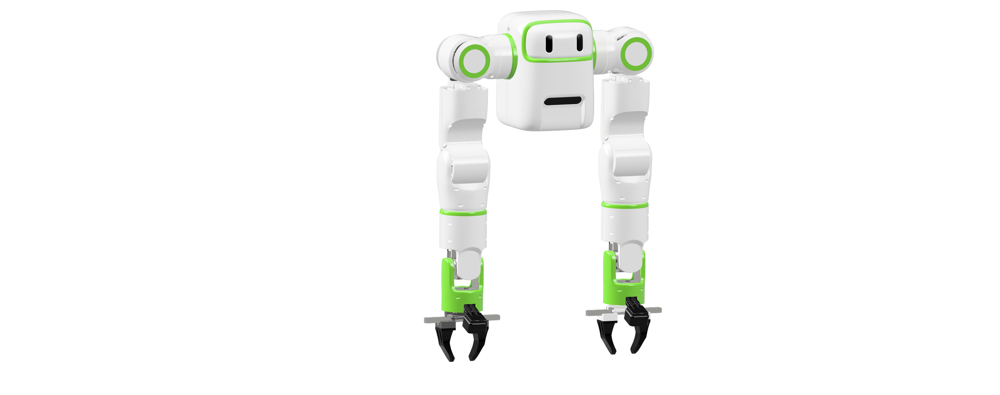
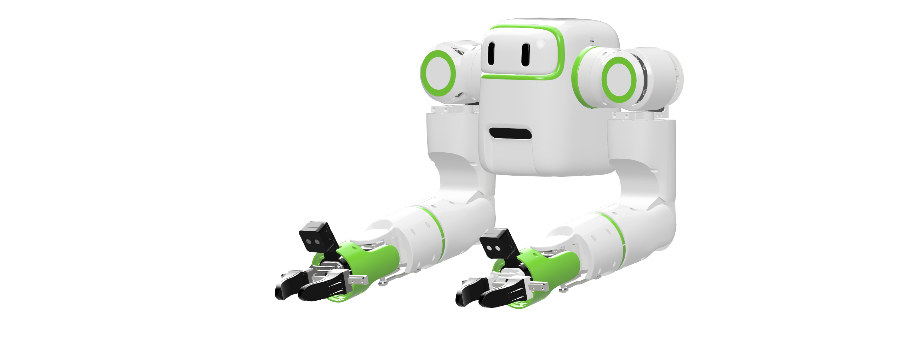
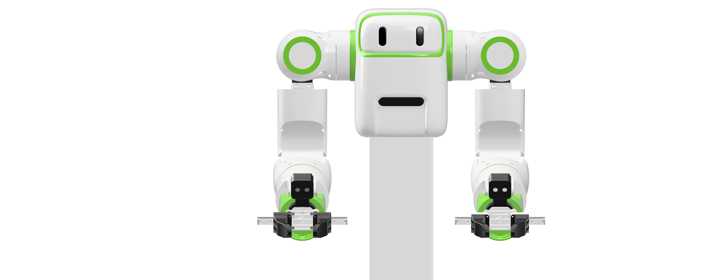
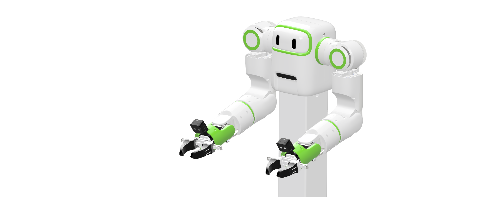
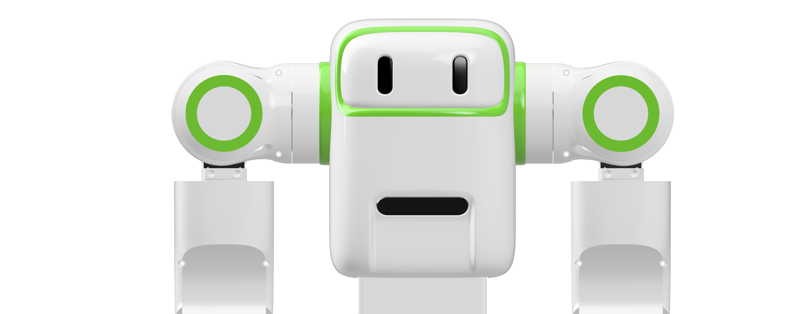
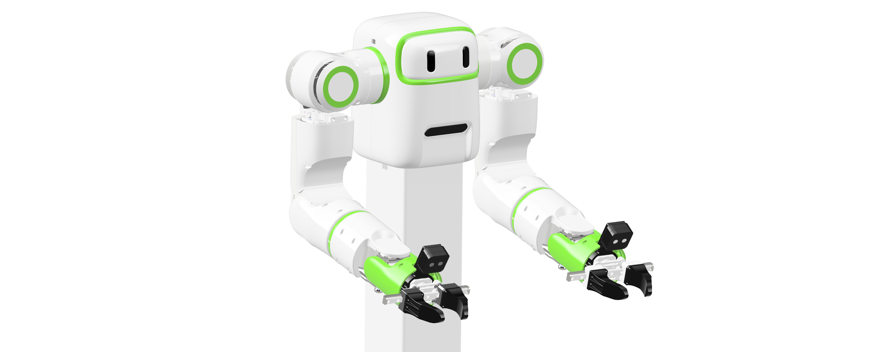

# 🤖 reBot Arm Twin Series

**Giving Physical AI Two Arms: Continuing the open-source legacy of reBot, a 7-DOF bimanual robotic arm**

**100% Open Source · Bimanual · Physical AI · Real-World Data**

🔓 Releasing in the open, step by step — follow the [Roadmap](#%EF%B8%8F-roadmap-and-status) and watch this repository for every drop.

🌐 [Tutorial Center](https://wiki.seeedstudio.com/robotics_page/) · 🦾 [Predecessor: reBot-DevArm B601](https://github.com/Seeed-Projects/reBot-DevArm)

[简体中文](README_zh.md) · [English](README.md)

---

## 📑 Contents

- [📖 Introduction](#-introduction)
- [✨ Why Two Hands](#-why-two-hands)
- [📸 Gallery](#-gallery)
- [🛒 Get Your reBot T701](#-get-your-rebot-t701)
- [⚙️ Hardware Overview](#%EF%B8%8F-hardware-overview)
- [🗺️ Roadmap and Status](#%EF%B8%8F-roadmap-and-status)
- [🌟 Community Showcase](#-community-showcase)
- [🙌 Acknowledgments and Contributors](#-acknowledgments-and-contributors)
- [📄 License](#-license)
- [☎ Contact Us](#-contact-us)

---

## 📖 Introduction

**reBot Arm T701** is an open-source, product-grade, plug-and-play **bimanual robotic platform** for Physical AI, Robot Learning, and real-world data collection — launched by **Seeed Studio**.

Over the past few years, robot learning has advanced at an astonishing pace — from ACT and Diffusion Policy to LeRobot and today's VLAs. But one thing hasn't kept up: **the models got cheaper, the robots stayed expensive.** That is why we built the [reBot Arm B601](https://github.com/Seeed-Projects/reBot-DevArm), so that an ordinary developer, student, or lab could afford a real research-grade arm — and own it truly: not just an SDK, not just a URDF, but the structure, the BOM, the software, and the tutorials.

Then the community asked the obvious next question: *“Can it have two arms?”*

| | | |
| :---: | :---: | :---: |
| **SO-Arm** | **reBot Arm B601** | **reBot Arm T701** |
| Let more people own their first robot. | Let more people own a real, high-performance open-source arm. | Let more people own a pair of open hands for Physical AI. |

T701 is our answer. A torso, two 7-DOF arms, two grippers, head and wrist vision, edge compute — fully open:

- 🦾 **Two 7-DOF arms + grippers** — a complete bimanual platform on one torso, driven by CAN-bus joint actuators.
- 🛠️ **Full hardware transparency** — CAD, BOM, assembly guide, software, and tutorials, released step by step (see the [Roadmap](#%EF%B8%8F-roadmap-and-status)).
- 📷 **Vision & compute ready** — RealSense D405 wrist cameras, D435 head mount, Jetson Orin mount, and the UniBox 7-CAN control board.
- 🌍 **SeeedStudio supply chain × global community** — an experiment in what happens when mature robotics manufacturing is truly opened to the world's developers.

**Open. Buildable. Reproducible.**

## ✨ Why Two Hands

Unscrew a bottle cap. Fold a towel. Plug in a cable. Assemble a part. Humans solved these problems millions of years ago — with two hands.

| Single arm | Two hands |
| :--- | :--- |
| Grips the bottle… and can't twist the cap | One hand holds, one hand rotates |
| Needs a fixture for every assembly | One hand fixes, one hand operates |
| Folds laundry one corner at a time | Coordinates both sides at once |
| Waits for someone to hold the cable | One hand steadies, one hand plugs |

Bimanual manipulation is where Physical AI research is heading — and the hardware to collect real bimanual data has been either closed, or priced for corporations. T701 exists to change that.

**One hand lets a robot learn to manipulate. Two hands let it start working.**

## 📸 Gallery

| | | | |
| :---: | :---: | :---: | :---: |
|  |  |  |  |
|  |  |  |  |

More photos, details, and hardware deep dives will be published as each Roadmap phase lands — watch ⭐ the repository.

## 🛒 Get Your reBot T701

Complete kits and pre-assembled units are in preparation and will be available at SeeedStudio.com — **coming soon**.

Everything you need to build one yourself — CAD files, BOM, and the assembly guide — will be published in this repository step by step. No lock-in, no waiting list: when it's released, it's yours.

## ⚙️ Hardware Overview

Designed as a desktop bimanual data-collection and manipulation platform: one torso, two arms, head + wrist vision, and edge AI compute.

| Parameter | Value |
| :--- | :--- |
| Configuration | Bimanual torso platform: 2 × 7-DOF arms + 2 × 1-DOF grippers |
| Total actuated axes | 14 + 2 grippers |
| Joint actuators | CAN-bus joint actuators (full model list with the BOM release) |
| End effectors | Parallel-jaw grippers, rail slide, replaceable fingers |
| Wrist vision | Intel RealSense D405 mounts ×2 (one per arm) |
| Head vision | Intel RealSense D435 mount |
| Compute | NVIDIA Jetson Orin mount (power & CAN via UniBox 7-CAN board) |
| Structure | CNC aluminum · sheet metal · resin & PETG shells |
| Payload / reach / weight | To be published with the specifications release |

## 🗺️ Roadmap and Status

We open-source in the open — step by step. Every item below lands in this repository on (or around) its target date:

| Item | Status | Target | Description |
| :--- | :---: | :---: | :--- |
| Platform reveal · renders | ✅ Released | 2026-10 | First photo set and platform introduction |
| Hardware specifications | ⏳ Planned | 2026-11 | Full spec sheet and hardware deep dive |
| CAD · STEP files | ⏳ Planned | 2026-11 | Full-assembly STEP + 101 individual part files |
| BOM | ⏳ Planned | 2026-11 | Materials, finishes, quantities, reference images |
| Assembly guide | ⏳ Planned | 2026-11 | Step-by-step assembly documentation (photos & text) |
| Python SDK | ⏳ Planned | 2026-11 | Motor comm, joint/MIT control, kinematics, QP IK, trajectories, teleoperation |
| URDF model | ⏳ Planned | 2026-11 | 14-axis dual-arm URDF + STL meshes |
| VR teleoperation (Meta Quest) | ⏳ Planned | 2026-11 | WebXR → WebSocket → UDP streaming, DLS/QP control |
| Calibration guide | ⏳ Planned | 2026-11 | Zero-position and kinematic calibration |
| ROS 2 integration | ⏳ Planned | 2027-12 | Kinematics, planning, teleoperation |
| LeRobot integration | ⏳ Planned | 2027-12 | Teleoperate → Record → Train → Deploy |
| MJCF / USD models | ⏳ Planned | 2027-12 | LeRobot & Isaac-ready simulation models |
| Isaac Sim simulation | ⏳ Planned | 2027-12 | Simulated teleoperation, synthetic data |
| Datasets & benchmarks | ⏳ Planned | 2027-12 | Community bimanual datasets on the T701 |

> 📅 Target dates are current estimates and may shift — star and watch the repository to catch each release.

## 🌟 Community Showcase

This section will feature T701 builds from around the world — datasets, demos, hacks, and unexpected uses. The first entries are yours to make.

Meanwhile, see what the community built with its predecessor, the [reBot Arm B601](https://github.com/Seeed-Projects/reBot-DevArm#-community-showcase).

*Submit your project via PR or reach us on [Discord](https://discord.gg/AbGuqJhDpQ) — welcome to become a contributor!*

## 🙌 Acknowledgments and Contributors

The path of open source is never lonely. The reBot Arm T701 would not exist without the support of Seeed Studio and the global open-source community.

**🌍 Ecosystem & Software Support**

- [Seeed Studio](https://www.seeedstudio.com/) — hardware supply chain, manufacturing, and developer community
- [Hugging Face LeRobot](https://github.com/huggingface/lerobot) — end-to-end robot learning framework
- [NVIDIA Isaac Sim](https://developer.nvidia.com/isaac/sim) — robot simulation and synthetic data platform

**💡 Inspiration**

- [SO-ARM100](https://github.com/TheRobotStudio/SO-ARM100/tree/main)
- [OpenArm](https://openarm.dev/)
- [OpenArmX](https://github.com/openarmx)
- [Mobile ALOHA](https://github.com/tonyzhaozh/aloha)
- [reBot Arm B601](https://github.com/Seeed-Projects/reBot-DevArm) — our own predecessor

**👥 Contributors**

*Coming soon — welcome to submit PRs and become a contributor!*

## 📄 License

- **Hardware Design** © 2026 Seeed Studio Co., Ltd. — open sourced under [CERN-OHL-W-2.0](https://ohwr.org/cern_ohl_w_v2.txt) (full license text in [LICENSE](./LICENSE); CAD and BOM files land with their Roadmap release).
- Software and firmware will be published under their own open-source licenses together with each code release.

## ☎ Contact Us

- **Open-Source Progress & Technical Support** — Yaohui: yaohui.zhu@seeed.cc
- **Future Collaboration & Customization** — Elaine: elaine.wu@seeed.cc
