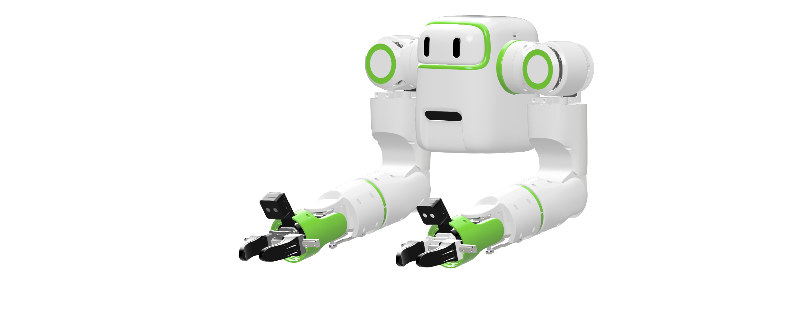
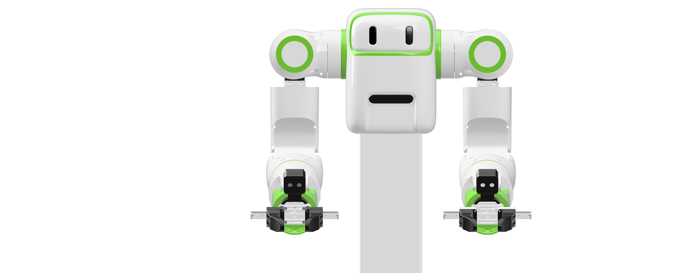
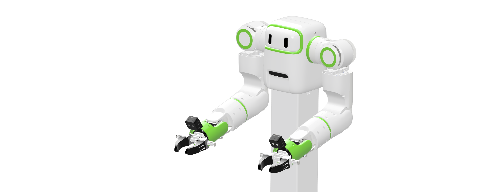
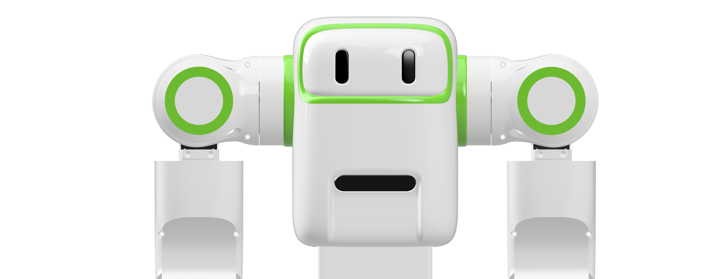
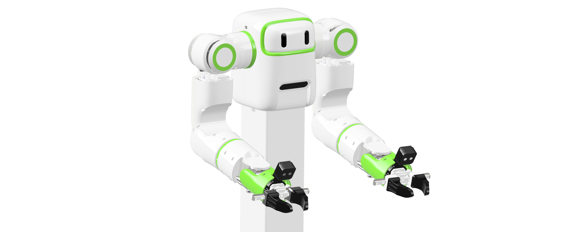

# 🤖 reBot Arm T701

**赋予物理 AI 双臂：延续 reBot 开源传承，7 自由度双臂机械臂**

**100% 开源 · 双臂 · Physical AI · 真实世界数据采集**

🔓 分步开源，逐步放出 —— 关注 [Roadmap](#%EF%B8%8F-roadmap-与状态) 与本仓库，不错过每一次发布。

🌐 [教程中心](https://wiki.seeedstudio.com/robotics_page/) · 🦾 [上一代：reBot-DevArm B601](https://github.com/Seeed-Projects/reBot-DevArm)

[简体中文](README_zh.md) · [English](README.md)

---

## 📑 目录

- [📖 项目介绍](#-项目介绍)
- [✨ 为什么需要两只手](#-为什么需要两只手)
- [📸 图库](#-图库)
- [🛒 获取你的 reBot T701](#-获取你的-rebot-t701)
- [⚙️ 硬件概览](#%EF%B8%8F-%E7%A1%AC%E4%BB%B6%E6%A6%82%E8%A7%88)
- [🗺️ Roadmap 与状态](#%EF%B8%8F-roadmap-与状态)
- [🌟 社区展示](#-社区展示)
- [🙌 致谢与贡献者](#-致谢与贡献者)
- [📄 许可证](#-许可证)
- [☎ 联系我们](#-联系我们)

---

## 📖 项目介绍

**reBot Arm T701** 是**Seeed Studio** 推出的一款面向 Physical AI、Robot Learning 与真实世界数据采集的开源、产品化、即插即用的**双臂机器人平台**。

过去几年，机器人学习进步飞快 —— 从 ACT、Diffusion Policy 到 LeRobot 和今天的各种 VLA，模型越来越强。但一个现实问题始终没有跟上：**模型越来越便宜，机器人硬件却依然很贵。** 于是我们做了 [reBot Arm B601](https://github.com/Seeed-Projects/reBot-DevArm)，让普通开发者、学生、实验室也能买得起一台真正的研究级机械臂，而且是真正地拥有它：不只是开放一个 SDK，不只是给一个 URDF，而是结构、BOM、软件、教程全部开放。

然后，社区问出了那个顺理成章的问题：*“能不能做双臂？”*

| | | |
| :---: | :---: | :---: |
| **SO-Arm** | **reBot Arm B601** | **reBot Arm T701** |
| 让更多人拥有第一台机器人。 | 让更多人拥有真正的高性能开源机械臂。 | 让更多人拥有一双属于 Physical AI 的开源之手。 |

T701 就是我们的答案 —— 一具躯干、两条 7 自由度手臂、两个夹爪、头部与腕部视觉、边缘算力，全部开放：

- 🦾 **双 7-DOF 手臂 + 夹爪** —— 单躯干完整双臂平台，CAN 总线关节电机驱动。
- 🛠️ **硬件完全透明** —— CAD、BOM、装配教程、软件与教程将分步开放（见 [Roadmap](#%EF%B8%8F-roadmap-与状态)）。
- 📷 **视觉与算力就绪** —— RealSense D405 腕部相机、D435 头部相机支架、Jetson Orin 计算模块支架与 UniBox 7-CAN 控制板。
- 🌍 **SeeedStudio供应链 × 全球开源社区** —— 一次“把成熟的机器人制造能力真正开放给全世界开发者”的实验。

**Open. Buildable. Reproducible.（开放。可制造。可复现。）**

## ✨ 为什么需要两只手

拧瓶盖、叠毛巾、插线缆、装配零件 —— 这些人类习以为常的事，几百万年前就靠两只手解决了。

| 单臂 | 双手 |
| :--- | :--- |
| 握住瓶子……却拧不开盖 | 一只手握持，一只手旋转 |
| 每次装配都需要夹具 | 一只手固定，一只手操作 |
| 一次只能叠一个角 | 双侧同时协调 |
| 等别人帮忙扶住线缆 | 一只手稳住，一只手插入 |

双臂操作（Bimanual Manipulation）正是 Physical AI 研究正在奔赴的方向 —— 而能采集真实双臂数据的硬件，此前要么封闭，要么贵到只有企业买得起。T701 就是为了改变这一点。

**一只手，让机器人学会操作。两只手，让机器人真正开始干活。**

## 📸 图库

| | | | |
| :---: | :---: | :---: | :---: |
|  |  |  |  |
|  |  |  |  |

随着 Roadmap 各阶段落地，将持续发布更多照片、细节与硬件深度解析 —— 欢迎 ⭐ 关注本仓库。

## 🛒 获取你的 reBot T701

完整套件与整机版本正在准备中，将上架 SeeedStudio.com —— **即将推出**。

自己动手打造一台所需的一切 —— CAD 文件、BOM 与装配教程 —— 都将分步发布在本仓库。没有锁定，没有等待名单：发布之时，即属于你。

## ⚙️ 硬件概览

面向桌面级双臂数据采集与操作平台设计：一具躯干、两条手臂、头部 + 腕部视觉、边缘 AI 算力。

| 参数 | 数值 |
| :--- | :--- |
| 构型 | 双臂躯干平台：2 × 7-DOF 手臂 + 2 × 1-DOF 夹爪 |
| 总驱动轴数 | 14 + 2 夹爪 |
| 关节电机 | CAN 总线关节电机（完整型号清单随 BOM 发布） |
| 末端执行器 | 平行夹爪，导轨滑动，手指可更换 |
| 腕部视觉 | Intel RealSense D405 支架 ×2（每臂一个） |
| 头部视觉 | Intel RealSense D435 支架 |
| 算力 | NVIDIA Jetson Orin 支架（供电与 CAN 经 UniBox 7-CAN 控制板） |
| 结构 | CNC 铝合金 · 钣金 · 树脂与 PETG 壳体 |
| 负载 / 臂展 / 重量 | 随硬件规格发布一同公布 |

## 🗺️ Roadmap 与状态

我们在开源的过程中开源（open-source in the open）—— 分步进行。下表每一项都会在目标日期前后落地到本仓库：

| 项目 | 状态 | 目标时间 | 说明 |
| :--- | :---: | :---: | :--- |
| 平台亮相 · 渲染图 | ✅ 已发布 | 2026-10 | 首批照片与平台介绍 |
| 硬件规格 | ⏳ 计划中 | 2026-11 | 完整规格表与硬件深度解析 |
| CAD · STEP 文件 | ⏳ 计划中 | 2026-11 | 整机装配 STEP + 101 个零件文件 |
| BOM | ⏳ 计划中 | 2026-11 | 材质、处理、数量、参考图 |
| 装配教程 | ⏳ 计划中 | 2026-11 | 图文版逐步装配指南 |
| Python SDK | ⏳ 计划中 | 2026-11 | 电机通信、关节/MIT 控制、运动学、QP IK、轨迹、遥操作 |
| URDF 模型 | ⏳ 计划中 | 2026-11 | 14 轴双臂 URDF + STL 网格 |
| VR 遥操作（Meta Quest） | ⏳ 计划中 | 2026-11 | WebXR → WebSocket → UDP 转发，DLS/QP 控制 |
| 标定教程 | ⏳ 计划中 | 2026-11 | 零位与运动学标定 |
| ROS 2 集成 | ⏳ 计划中 | 2027-12 | 运动学、规划、遥操作 |
| LeRobot 集成 | ⏳ 计划中 | 2027-12 | Teleoperate → Record → Train → Deploy |
| MJCF / USD 模型 | ⏳ 计划中 | 2027-12 | 面向 LeRobot 与 Isaac 的仿真模型 |
| Isaac Sim 仿真 | ⏳ 计划中 | 2027-12 | 仿真遥操作、合成数据 |
| 数据集与 Benchmark | ⏳ 计划中 | 2027-12 | 面向社区的 T701 双臂数据集 |

> 📅 目标时间为当前计划，可能调整 —— Star 并 Watch 本仓库，不错过每一次发布。

## 🌟 社区展示

这里将展示来自世界各地的 T701 作品 —— 数据集、Demo、Hack 与意想不到的用法。第一批内容，等你来写。

在此之前，欢迎看看社区用它的上一代 [reBot Arm B601](https://github.com/Seeed-Projects/reBot-DevArm#-community-showcase) 做出了什么。

*欢迎通过 PR 提交你的项目，或到 [Discord](https://discord.gg/AbGuqJhDpQ) 找我们 —— 期待你成为贡献者！*

## 🙌 致谢与贡献者

开源的路上从不孤单。reBot Arm T701 的诞生离不开 Seeed Studio 与全球开源社区的支持。

**🌍 生态与软件支持**

- [Seeed Studio](https://www.seeedstudio.com/) —— 硬件供应链、制造与开发者社区
- [Hugging Face LeRobot](https://github.com/huggingface/lerobot) —— 端到端机器人学习框架
- [NVIDIA Isaac Sim](https://developer.nvidia.com/isaac/sim) —— 机器人仿真与合成数据平台

**💡 灵感来源**

- [SO-ARM100](https://github.com/TheRobotStudio/SO-ARM100/tree/main)
- [OpenArm](https://openarm.dev/)
- [OpenArmX](https://github.com/openarmx)
- [Mobile ALOHA](https://github.com/tonyzhaozh/aloha)
- [reBot Arm B601](https://github.com/Seeed-Projects/reBot-DevArm) —— 我们自己的上一代产品

**👥 贡献者**

*Coming soon —— 欢迎提交 PR，成为贡献者！*

## 📄 许可证

- **硬件设计** © 2026 Seeed Studio Co., Ltd. —— 以 [CERN-OHL-W-2.0](https://ohwr.org/cern_ohl_w_v2.txt) 开源（全文见 [LICENSE](./LICENSE)；CAD 与 BOM 文件随 Roadmap 对应阶段发布）。
- 软件与固件将随各代码发布一同公布其开源许可证。

## ☎ 联系我们

- **开源进度与技术支持** —— Yaohui：yaohui.zhu@seeed.cc
- **合作与定制** —— Elaine：elaine.wu@seeed.cc
