# 🤖 reBot Arm T701 — Open-Source Hardware Specification

  

  <strong>
    <a href="./README_zh.md">简体中文</a> &nbsp;|&nbsp;
    <a href="./README.md">English</a>
  </strong>

| Date | Version | File Name | Changelog |
|----------|------|----------|------|
| 2026-10-20 | v1.0 | reBot_T701_v1.0_20261020.step | Initial release: full-assembly STEP, 98 part STEP files, and the complete BOM with reference images |

This is the open-source hardware package for the **reBot Arm T701**, a bimanual robotic platform for Physical AI from **Seeed Studio**. Unless stated otherwise, quantities below are totals for **one complete T701** (torso + two 7-DOF arms + two grippers).

# 📦 File Structure
*   **3D_Printed_Parts/**: STEP files for all printed and molded parts (resin shells and covers, PETG mounts, gripper fingers).
*   **Metal_Parts/**: STEP files for all CNC-machined and sheet-metal parts.
*   **Purchased_Parts/**: STEP models of purchased components (joint actuators, bearings, rails, fasteners, cameras, controller).
*   **reBot_T701_v1.0_20261020.step**: the full dual-arm assembly (≈200 MB, stored via Git LFS — see the repository root README).

# 🛒 Get the Parts
Purchase the complete robot:

| Channel | Region | Link |
| :--- | :--- | :--- |
| Seeed Studio | Global | [reBot Arm T701](https://www.seeedstudio.com/reBot-Arm-T701-HT-p-7044.html) |
| Tmall flagship store | Mainland China | [reBot Arm T701](https://detail.tmall.com/item.htm?id=1097802431280) |
| JD flagship store | Mainland China | [reBot Arm T701](https://item.jd.com/10239223747089.html) |

- Every part can also be sourced or fabricated independently using the BOM below.

# 📊 Bill of Materials (BOM)

> [!WARNING]
> The published BOM reflects the open-source v1.0, optimized for builders to reproduce at reasonable cost; some non-essential details are simplified. The final Seeed production version may adjust clearances, finishes and wiring for factory variation. The mechanical structure remains identical.

## 💰 Cost Estimate (2026-11 reference)

| Category | Intl. (USD) | CN (CNY) | Notes |
| :--- | :---: | :---: | :--- |
| CNC machined parts | ≈ $300 | ≈ ¥2,010 | internal machining estimate |
| Sheet-metal parts | ≈ $500 | ≈ ¥3,350 | internal machining estimate |
| Resin (SLA) printed parts | ≈ $200 | ≈ ¥1,340 | printing material & processing estimate |
| FDM / other printed parts | ≈ $50 | ≈ ¥335 | printing material estimate |
| Gripper fingers (urethane cast) | ≈ $30 | ≈ ¥201 | molding estimate |
| Joint actuators ×16 | ≈ $3,666 | ≈ ¥24,562 | Seeed unit price × qty (7256 DNE $309/pc and 5047 $200/pc are estimates, not yet listed) |
| Screws / fasteners (36 specs) | ≈ $283 | ≈ ¥72 | one pack per spec (Amazon) / Taobao starting-price total |
| Standard parts (bearings / rails / standoffs / clamp) | ≈ $143 | ≈ ¥48 | Amazon reference / Taobao starting-price total |
| Sensors (D405 ×2 + D435i ×1) | ≈ $1,448 | ≈ ¥9,702 | Amazon reference |
| **Full hardware total** | **≈ $6,620** | **≈ ¥41,620** | excl. custom wiring harness and the UniBox 7-CAN controller board |

> Prices captured 2026-11 (Amazon / Seeed / Taobao) and **fluctuate with manufacturer and market conditions** — for budgeting only. CN reference converted at 1 USD ≈ 6.7 CNY (screws and standard parts at actual Taobao prices); CN sourcing of standard parts and screws is typically well below the international reference.

---

## ⚙️ CNC Machined Parts

| Part Description | Image | File Name | Material / Finish | Qty | Notes |
|----------|------|--------|------|----------|------|
| Shoulder Mounting Flange | 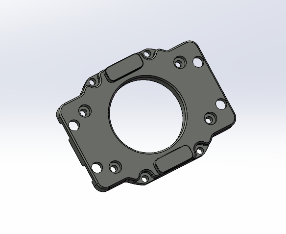 | [Part_02_Shoulder_Mounting_Flange.step](./Metal_Parts/Part_02_Shoulder_Mounting_Flange.step) | CNC · 6061 aluminum · matte clear anodize | 2 PCS | — |
| Joint 1 Limit Block | 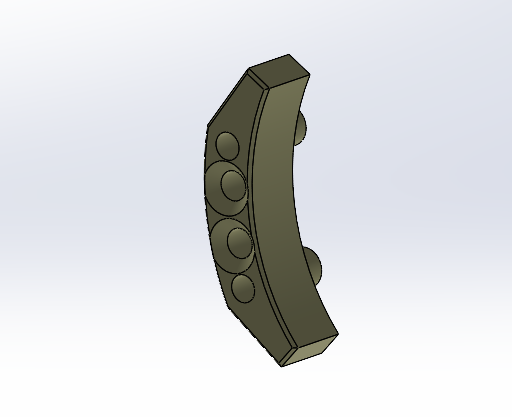 | [Part_02_Joint_1_Limit_Block.step](./Metal_Parts/Part_02_Joint_1_Limit_Block.step) | CNC · 6061 aluminum · matte clear anodize | 2 PCS | — |
| Link Joint1 Joint2 | 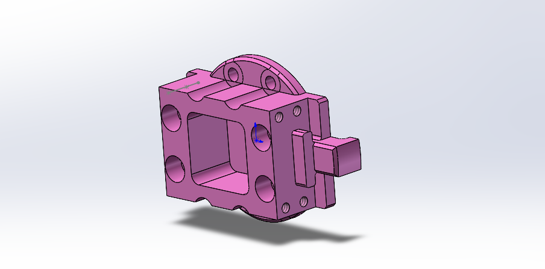 | [Part_02_Link_Joint1_Joint2.step](./Metal_Parts/Part_02_Link_Joint1_Joint2.step) | CNC · 6061 aluminum · matte clear anodize | 2 PCS | — |
| Joint2 Mount A | 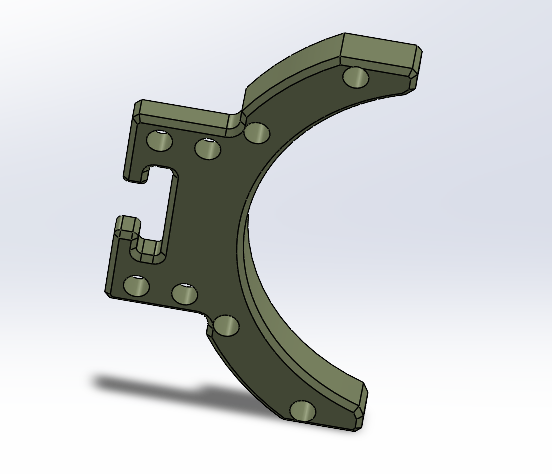 | [Part_02_Joint2_Mount_A.step](./Metal_Parts/Part_02_Joint2_Mount_A.step) | CNC · 6061 aluminum · matte clear anodize | 2 PCS | — |
| Joint2 Mount B | 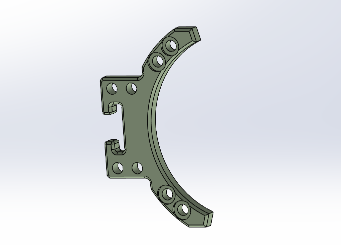 | [Part_02_Joint2_Mount_B.step](./Metal_Parts/Part_02_Joint2_Mount_B.step) | CNC · 6061 aluminum · matte clear anodize | 2 PCS | — |
| Link Joint2 Joint3 A | 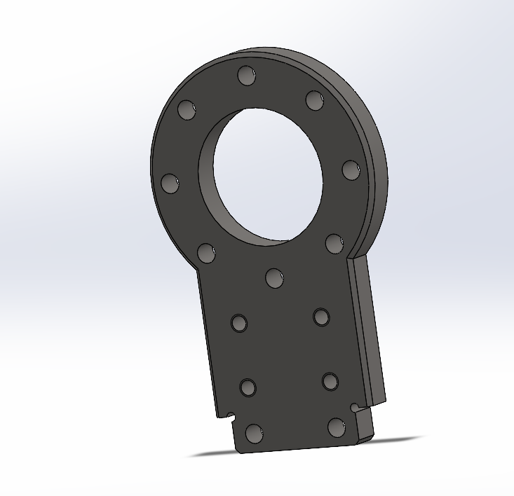 | [Part_02_Link_Joint2_Joint3_A.step](./Metal_Parts/Part_02_Link_Joint2_Joint3_A.step) | CNC · 6061 aluminum · matte clear anodize | 2 PCS | — |
| Link Joint2 Joint3 B | 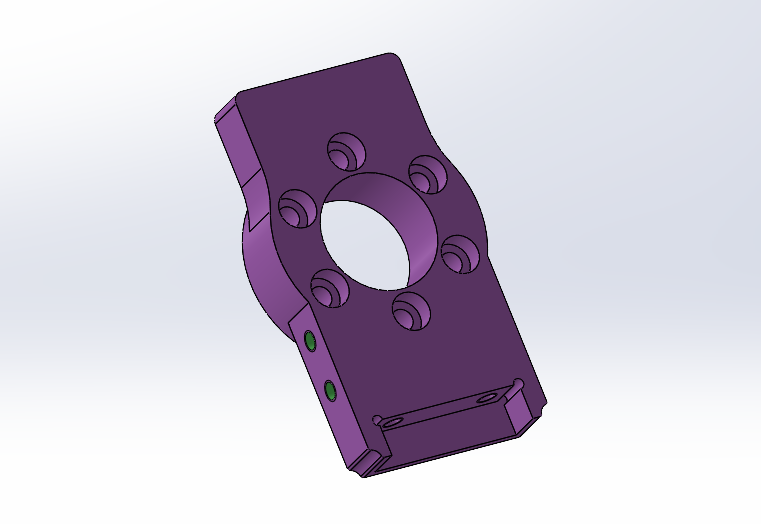 | [Part_02_Link_Joint2_Joint3_B.step](./Metal_Parts/Part_02_Link_Joint2_Joint3_B.step) | CNC · 6061 aluminum · matte clear anodize | 2 PCS | — |
| J6 link output flange | 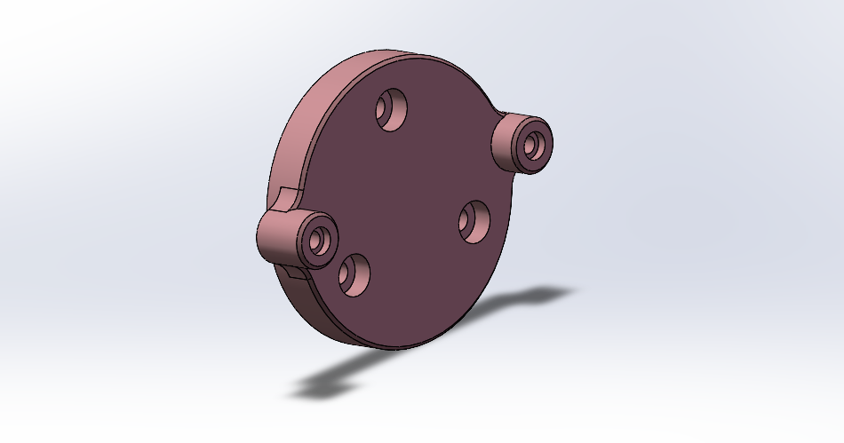 | [Part_02_J6_link_output_flange.step](./Metal_Parts/Part_02_J6_link_output_flange.step) | CNC · 6061 aluminum · matte clear anodize | 2 PCS | — |
| wrist link A | 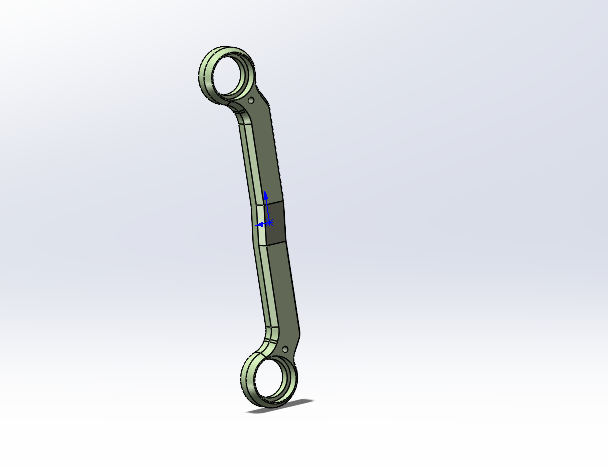 | [Part_02_wrist_link_A.step](./Metal_Parts/Part_02_wrist_link_A.step) | CNC · 7075 aluminum · matte clear anodize | 2 PCS | — |
| wrist link B | 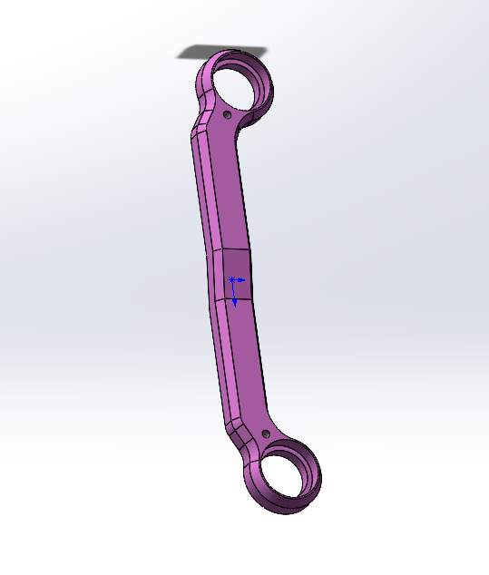 | [Part_02_wrist_link_B.step](./Metal_Parts/Part_02_wrist_link_B.step) | CNC · 6061 aluminum · matte clear anodize | 2 PCS | — |
| Bearing Mount B | 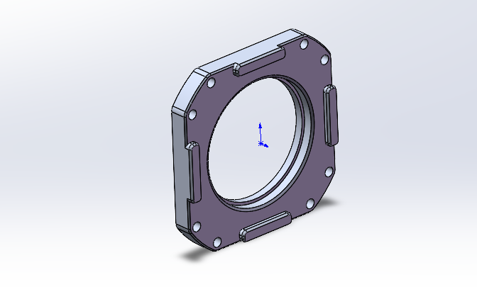 | [Part_02_Bearing_Mount_B.step](./Metal_Parts/Part_02_Bearing_Mount_B.step) | CNC · 6061 aluminum · matte clear anodize | 2 PCS | — |
| Bearing Mount A | 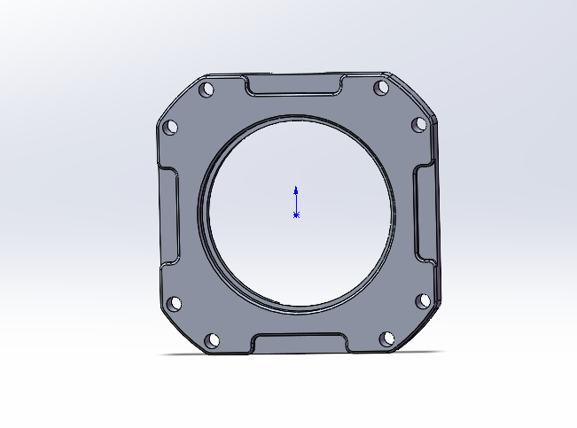 | [Part_02_Bearing_Mount_A.step](./Metal_Parts/Part_02_Bearing_Mount_A.step) | CNC · 6061 aluminum · matte clear anodize | 2 PCS | — |
| J4 Coupling D | 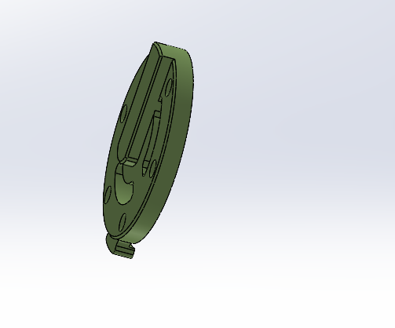 | [Part_02_J4_Coupling_D.step](./Metal_Parts/Part_02_J4_Coupling_D.step) | CNC · 6061 aluminum · matte clear anodize | 2 PCS | — |
| J5 Joint limit | 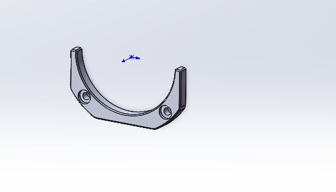 | [Part_02_J5_Joint_limit.step](./Metal_Parts/Part_02_J5_Joint_limit.step) | CNC · 6061 aluminum · matte clear anodize | 2 PCS | — |
| J5 Coupling | 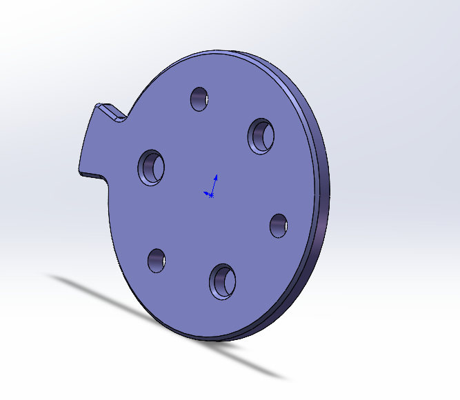 | [Part_02_J5_Coupling.step](./Metal_Parts/Part_02_J5_Coupling.step) | CNC · 6061 aluminum · matte clear anodize | 2 PCS | — |
| J7 flange A | 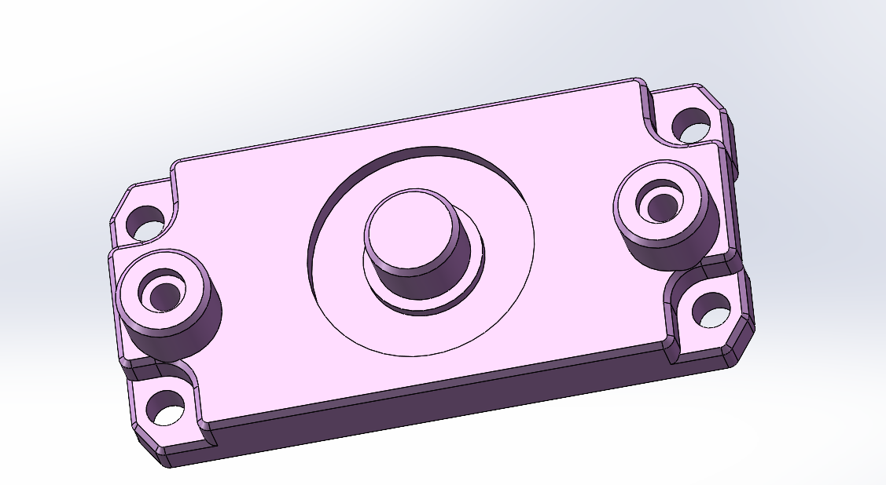 | [Part_02_J7_flange_A.step](./Metal_Parts/Part_02_J7_flange_A.step) | CNC · 6061 aluminum · 150# sandblast · matte black anodize | 2 PCS | — |
| J7 output side flange | 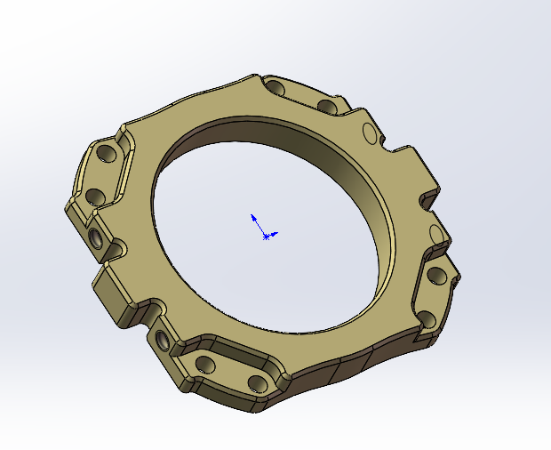 | [Part_02_J7_output_side_flange.step](./Metal_Parts/Part_02_J7_output_side_flange.step) | CNC · 6061 aluminum · 150# sandblast · matte black anodize | 2 PCS | — |
| J7 bearing bracket A | 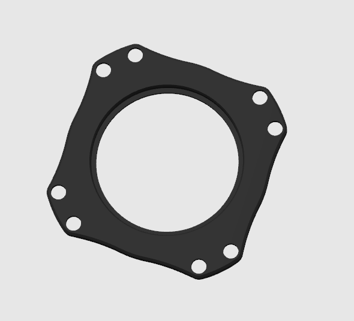 | [Part_02_J7_bearing_bracket_A.step](./Metal_Parts/Part_02_J7_bearing_bracket_A.step) | CNC · 6061 aluminum · 150# sandblast · matte black anodize | 2 PCS | — |
| J7 bearing bracket B | 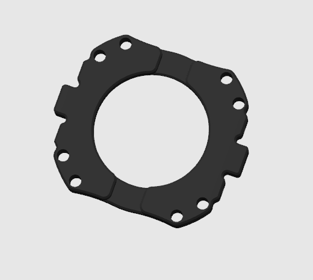 | [Part_02_J7_bearing_bracket_B.step](./Metal_Parts/Part_02_J7_bearing_bracket_B.step) | CNC · 6061 aluminum · 150# sandblast · matte black anodize | 2 PCS | — |
| J7 bearing bracket C | 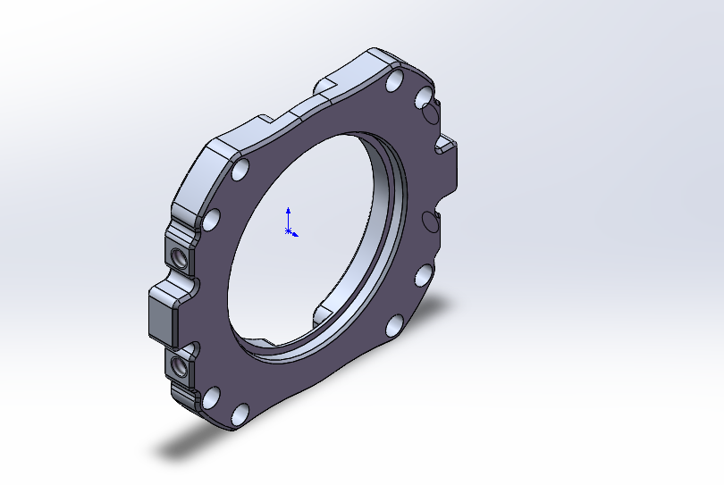 | [Part_02_J7_bearing_bracket_C.step](./Metal_Parts/Part_02_J7_bearing_bracket_C.step) | CNC · 6061 aluminum · 150# sandblast · matte black anodize | 2 PCS | — |
| J7 bearing bracket D | 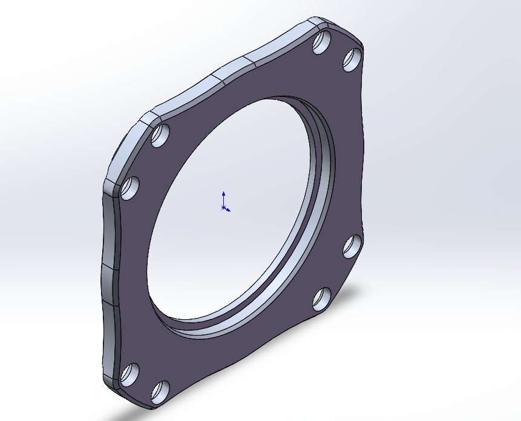 | [Part_02_J7_bearing_bracket_D.step](./Metal_Parts/Part_02_J7_bearing_bracket_D.step) | CNC · 6061 aluminum · 150# sandblast · matte black anodize | 2 PCS | — |
| J7 Output side shim | 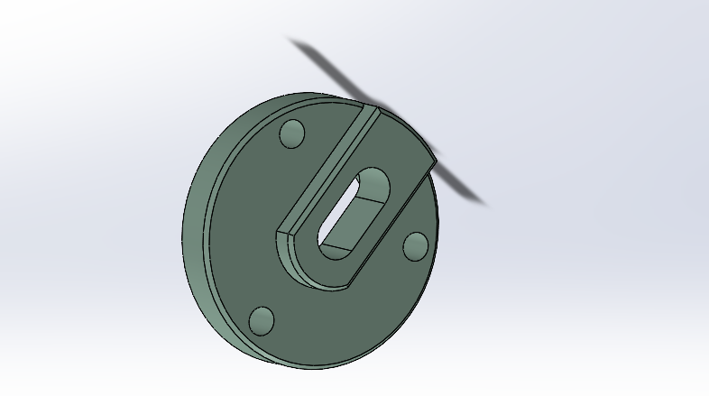 | [Part_02_J7_Output_side_shim.step](./Metal_Parts/Part_02_J7_Output_side_shim.step) | CNC · 6061 aluminum · 150# sandblast · matte black anodize | 2 PCS | — |
| J7 flange B | 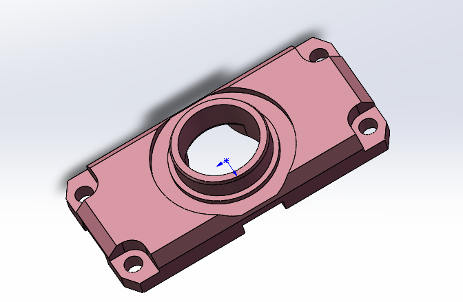 | [Part_02_J7_flange_B.step](./Metal_Parts/Part_02_J7_flange_B.step) | CNC · 6061 aluminum · 150# sandblast · matte black anodize | 2 PCS | — |
| J8 Gripper Mount | 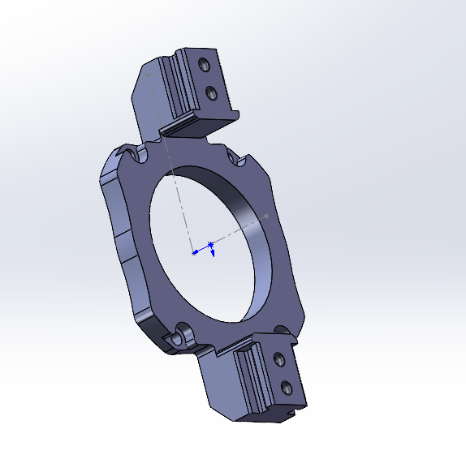 | [Part_02_J8_Grippter_Mount.step](./Metal_Parts/Part_02_J8_Grippter_Mount.step) | CNC · 6061 aluminum · 150# sandblast · matte black anodize | 2 PCS | — |
| Claw link A | 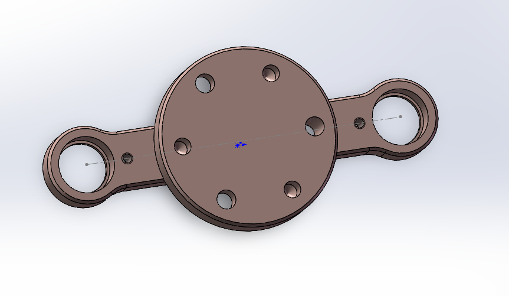 | [Part_02_Claw_link_A.step](./Metal_Parts/Part_02_Claw_link_A.step) | CNC · 6061 aluminum · 150# sandblast · matte black anodize | 2 PCS | — |
| Slide connector | 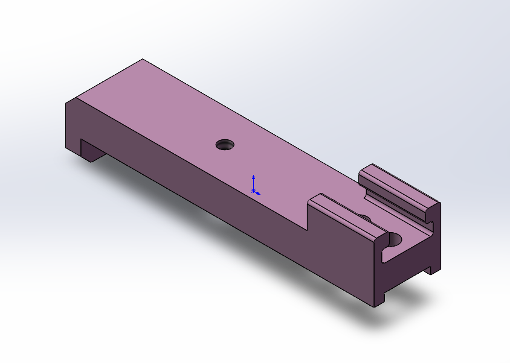 | [Part_02_Slide_connector.step](./Metal_Parts/Part_02_Slide_connector.step) | CNC · 6061 aluminum · 150# sandblast · matte black anodize | 4 PCS | — |
| Claw link B | 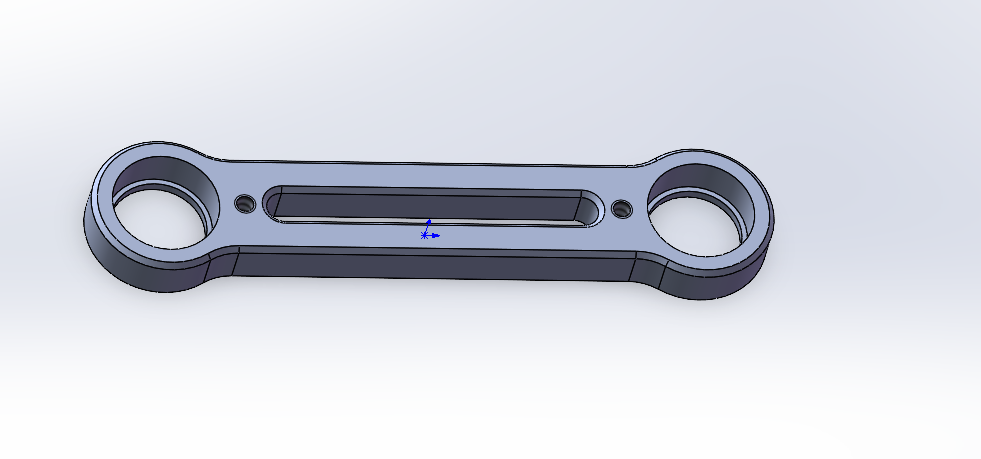 | [Part_02_Claw_link_B.step](./Metal_Parts/Part_02_Claw_link_B.step) | CNC · 6061 aluminum · 150# sandblast · matte black anodize | 4 PCS | — |
| Gripper Claw Connector | 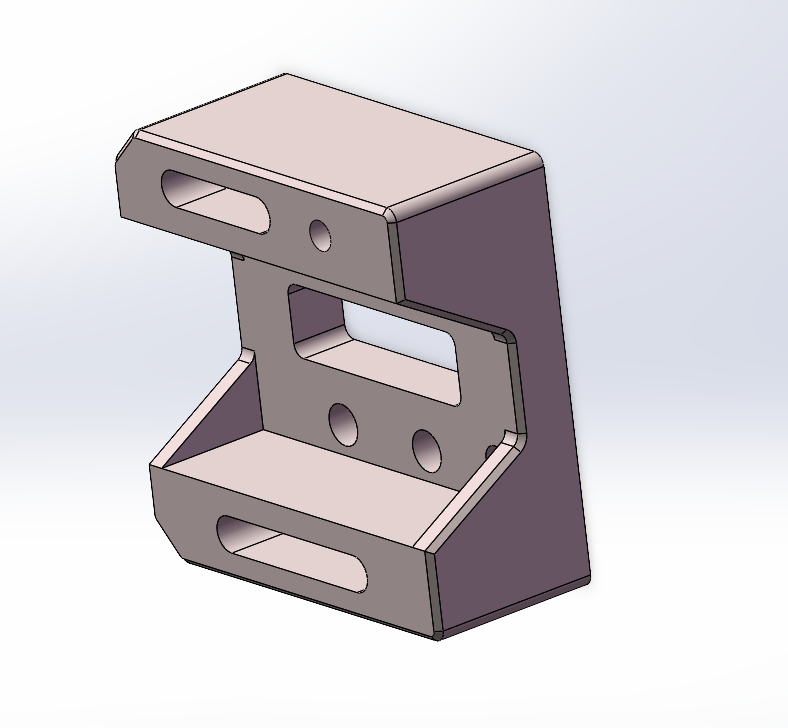 | [Part_02_Claw_Connector_B.step](./Metal_Parts/Part_02_Claw_Connector_B.step) | CNC · 6061 aluminum · 150# sandblast · matte black anodize | 4 PCS | — |
| J4 Coupling A | 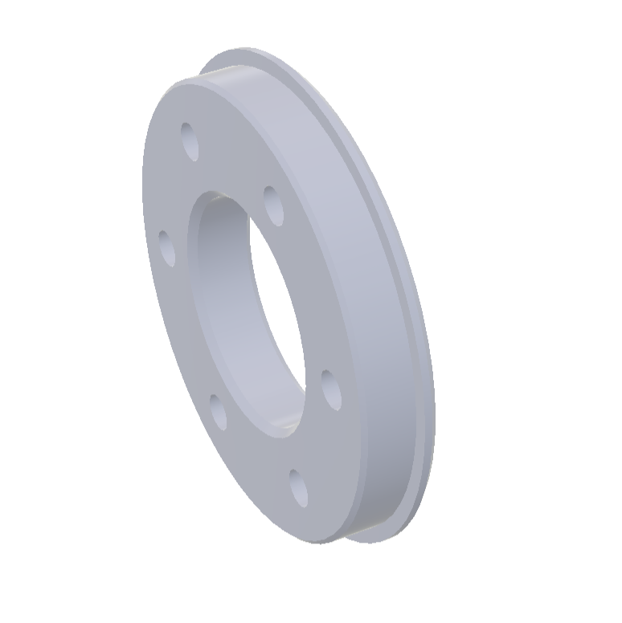 | [Part_02_J4_Coupling_A.step](./Metal_Parts/Part_02_J4_Coupling_A.step) | CNC · 6061 aluminum · 150# sandblast · matte black anodize | 2 PCS | — |
| J4 Coupling B | 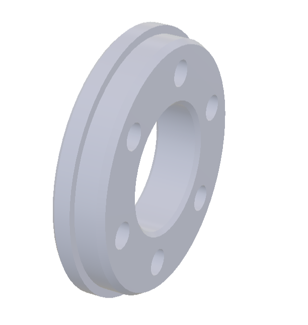 | [Part_02_J4_Coupling_B.step](./Metal_Parts/Part_02_J4_Coupling_B.step) | CNC · 6061 aluminum · 150# sandblast · matte black anodize | 2 PCS | — |
| J4 Coupling C | 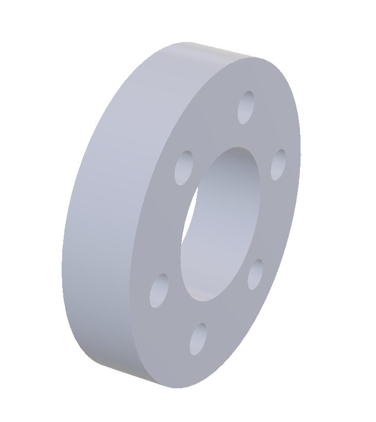 | [Part_02_J4_Coupling_C.step](./Metal_Parts/Part_02_J4_Coupling_C.step) | CNC · 6061 aluminum · 150# sandblast · matte black anodize | 2 PCS | — |

### 🧩 Machining Specifications
- Aluminum alloys: 6061 (structural links & mounts), 7075 (high-load wrist link)
- Key dimension tolerance: ±0.02 mm
- Surface finish: 150# sandblast + matte anodize (clear or black per part)

---

## 🔩 Sheet-Metal Parts

| Part Description | Image | File Name | Material / Finish | Qty | Notes |
|----------|------|--------|------|----------|------|
| Link Joint2 Joint3 C | 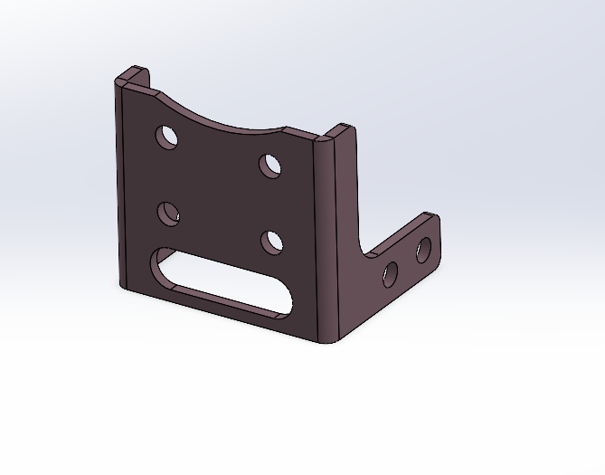 | [Part_02_Link_Joint2_Joint3_C.step](./Metal_Parts/Part_02_Link_Joint2_Joint3_C.step) | Sheet metal · 5052 aluminum · silver matte anodize | 2 PCS | #150 sandblast, anodize (silver matte, ≥15 µm) |
| Upper Arm Frames (Left & Right) | 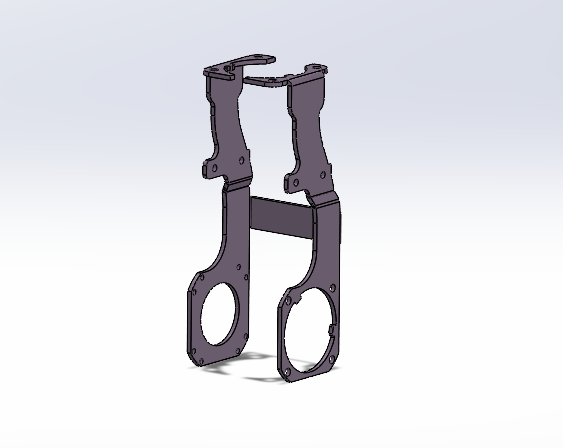 | [Part_02_Upper_arm_frame.step](./Metal_Parts/Part_02_Upper_arm_frame.step) [Part_02_Right_Upper_arm_frame.step](./Metal_Parts/Part_02_Right_Upper_arm_frame.step) | Sheet metal · 5052 aluminum · silver matte anodize | 1 PCS | — |
| J3 Motor Support Bracket | 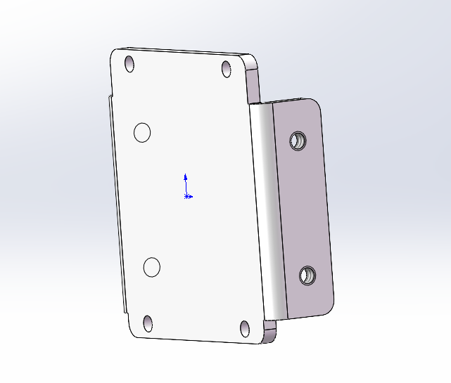 | [Part_02_J3_Motor_Support_Bracket.step](./Metal_Parts/Part_02_J3_Motor_Support_Bracket.step) | Sheet metal · 5052 aluminum · silver matte anodize | 2 PCS | — |
| Left Lower Frame A | 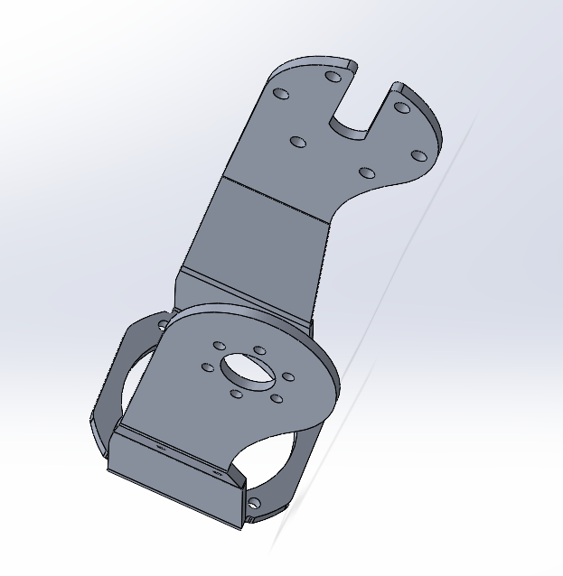 | [Part_02_Left_Lower_Frame_A.step](./Metal_Parts/Part_02_Left_Lower_Frame_A.step) | Sheet metal · 5052 aluminum · silver matte anodize | 1 PCS | — |
| Right Lower Frame A | 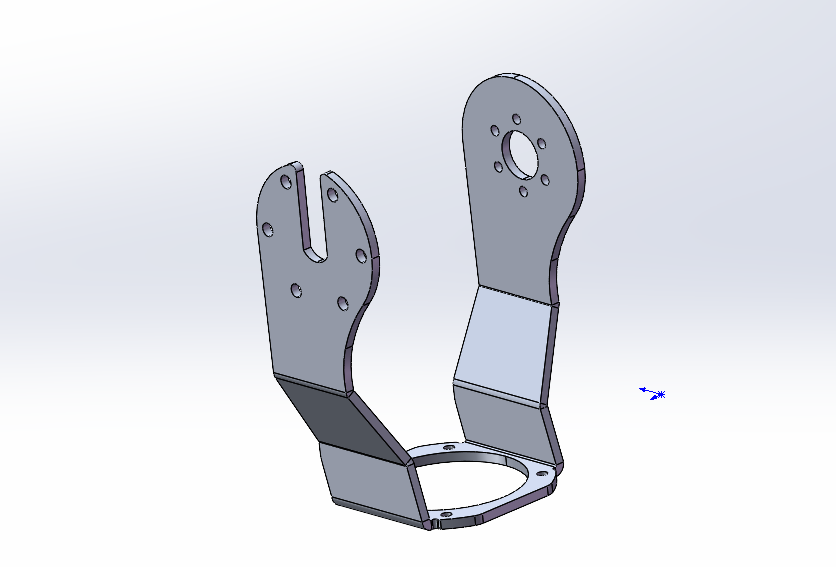 | [Part_02_Right_Lower_Frame_A.step](./Metal_Parts/Part_02_Right_Lower_Frame_A.step) | Sheet metal · 5052 aluminum · silver matte anodize | 1 PCS | — |
| Left Right Lower Frame | 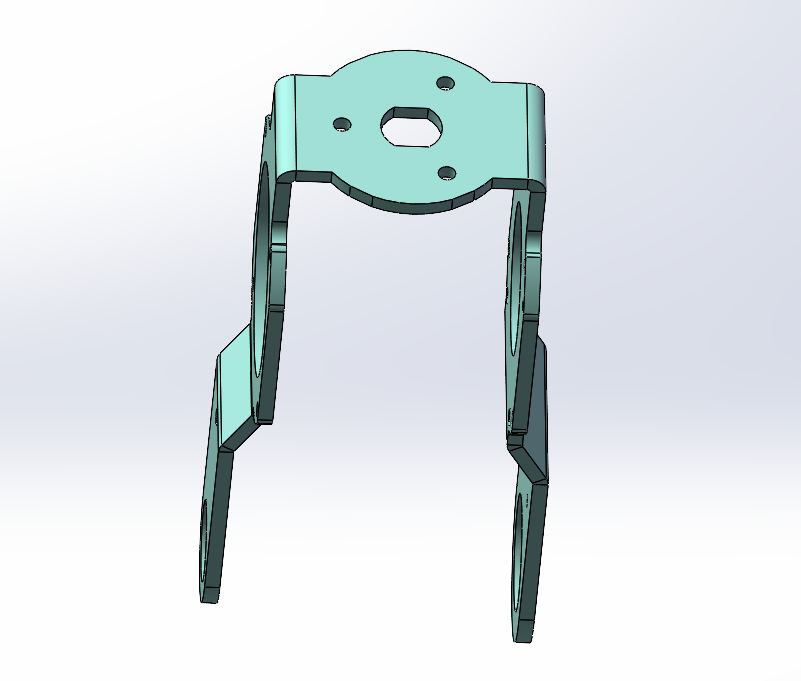 | [Part_02_Left_Right_Lower_Frame.step](./Metal_Parts/Part_02_Left_Right_Lower_Frame.step) | Sheet metal · 5052 aluminum · silver matte anodize | 2 PCS | — |
| Left Lower Frame B | 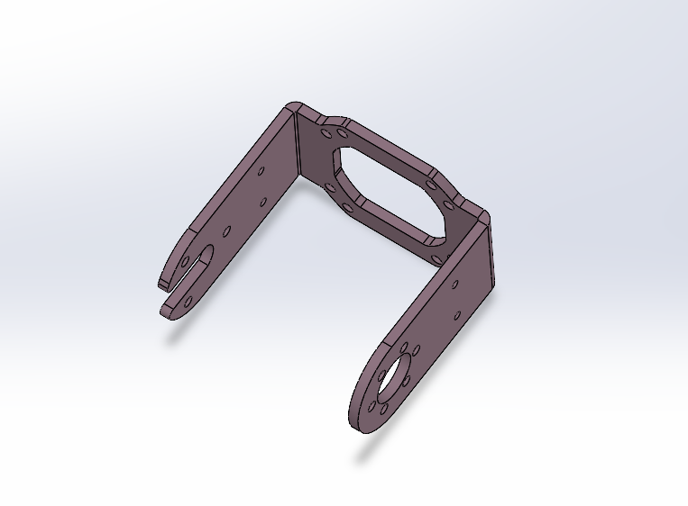 | [Part_02_Left_Lower_Frame_B.step](./Metal_Parts/Part_02_Left_Lower_Frame_B.step) | Sheet metal · 5052 aluminum · silver matte anodize | 2 PCS | — |
| Sheet Metal Base C | 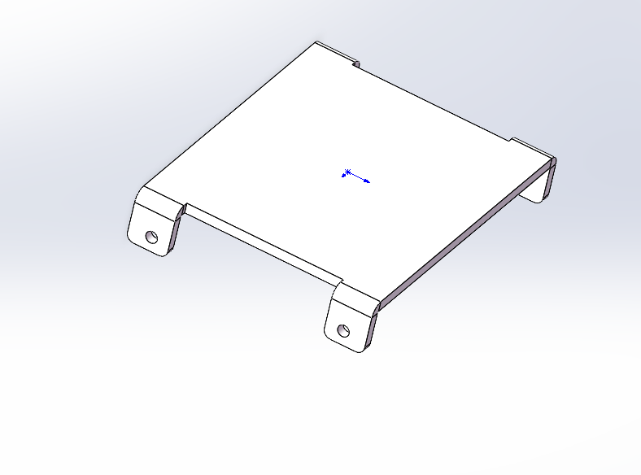 | [Part_02_Sheet_Metal_Base_C.step](./Metal_Parts/Part_02_Sheet_Metal_Base_C.step) | Sheet metal · 5052 aluminum · silver matte anodize | 1 PCS | — |
| Sheet Metal Base A | 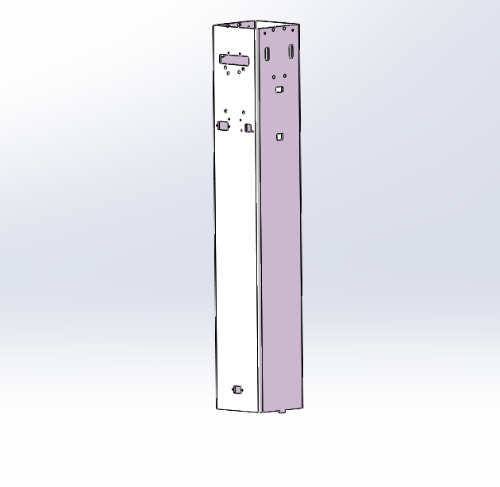 | [Part_02_Sheet_Metal_Base_A.step](./Metal_Parts/Part_02_Sheet_Metal_Base_A.step) | Sheet metal · steel (D235) · painted white | 1 PCS | Welded to Sheet Metal Base B |
| Sheet Metal Base B | 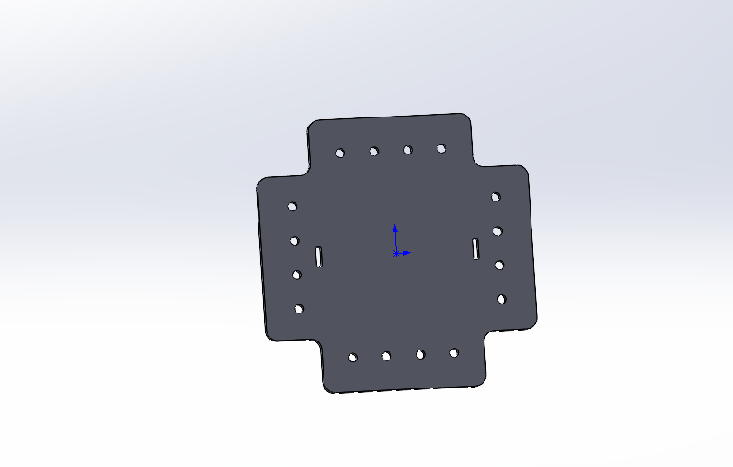 | [Part_02_Sheet_Metal_Base_B.step](./Metal_Parts/Part_02_Sheet_Metal_Base_B.step) | Sheet metal · steel (D235) · painted white | 1 PCS | Welded to Sheet Metal Base A |

> [!TIP]
> Sheet-metal parts can be ordered from any sheet-metal vendor (e.g. JLCPCB sheet-metal service). 5052 aluminum, ≥15 µm silver matte anodize.

---

## 🔌 Joint Actuators

CAN-bus joint actuators.

| Model | Image | File Name | Qty (Total) | Qty (Per Arm) | Used In | Seeed Store Link | Ref. Price |
|----------|------|--------|------|:---:|------|------|:---:|
| 7256 DNE Joint Actuator | 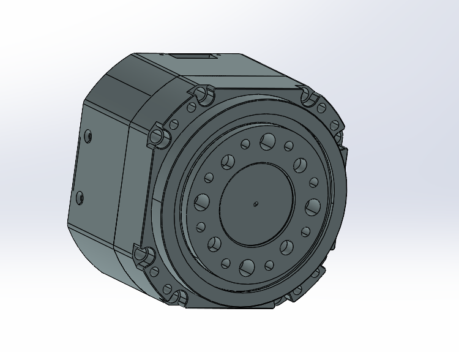 | [Part_03_7256_DNE.step](./Purchased_Parts/Part_03_7256_DNE.step) | 4 PCS | 2 | J1 / J2 | — (not yet listed) | $309 |
| 6056 Joint Actuator | 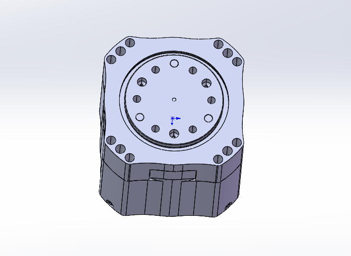 | [Part_03_6056_JC.step](./Purchased_Parts/Part_03_6056_JC.step) | 2 PCS | 1 | J3 | [HDTW-6056-36-NE-JC](https://www.seeedstudio.com/Hightorque-HDTW-6056-36-NE-JC-Actuator-p-6673.html) | $229 |
| 6056 Motor (standard) | — | [Part_03_6056.step](./Purchased_Parts/Part_03_6056.step) | 2 PCS | 1 | J4 | [HDTW-6056-36-NE](https://www.seeedstudio.com/Hightorque-HDTW-6056-36-NE-Actuator-p-6672.html) | $219 |
| 5036 Joint Actuator | 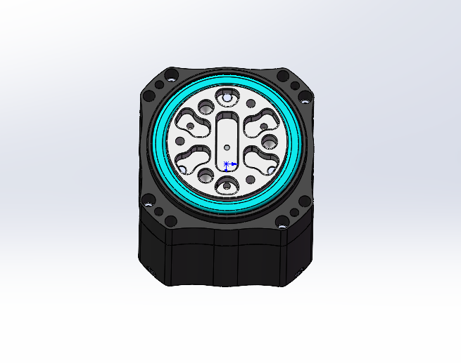 | [Part_03_5036.step](./Purchased_Parts/Part_03_5036.step) | 2 PCS | 1 | J5 | [HTDW-5036-02-DNE](https://www.seeedstudio.com/Hightorque-HTDW-5047-36-NE-Gear-Motor-p-6483.html) | $189 |
| 5047 Joint Actuator | 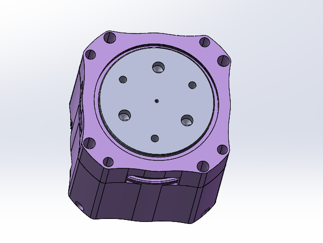 | [Part_03_5047.step](./Purchased_Parts/Part_03_5047.step) | 2 PCS | 1 | J6 | — (not yet listed) | $200 |
| 4438 Joint Actuator | 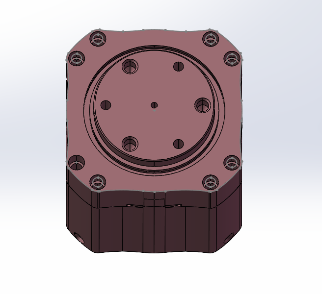 | [Part_03_4438.step](./Purchased_Parts/Part_03_4438.step) | 2 PCS | 1 | J7 | [HTDW-4438-30-NE](https://www.seeedstudio.com/Hightorque-HTDW-4438-30-NE-Gear-Motor-p-6482.html) | $189 |
| 4438 Joint Actuator |  | [Part_03_4438.step](./Purchased_Parts/Part_03_4438.step) | 2 PCS | 1 | Gripper (J8) | [HTDW-4438-30-NE](https://www.seeedstudio.com/Hightorque-HTDW-4438-30-NE-Gear-Motor-p-6482.html) | $189 |

> 💡 The 6056-JC is the crossed-roller version (J3); `Part_03_6056.step` is the standard version without crossed rollers (J4).
>
> 💰 **Total motor cost (16 units) ≈ $3,666** — Seeed unit price × qty; the 7256 DNE ($309/pc) and 5047 ($200/pc) are estimates and not yet listed.

---

## 🖨️ Resin (SLA) Printed Parts

| Part Description | Image | File Name | Material | Qty | Notes |
|----------|------|--------|------|----------|------|
| Front Torso Shell | 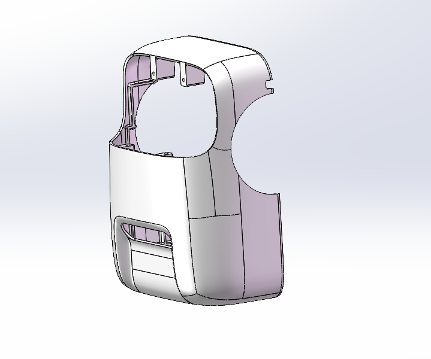 | [Part_01_Front_Torso_Shell.step](./3D_Printed_Parts/Part_01_Front_Torso_Shell.step) | SLA resin · white | 1 PCS | Sanded & painted |
| Back Torso Shell | 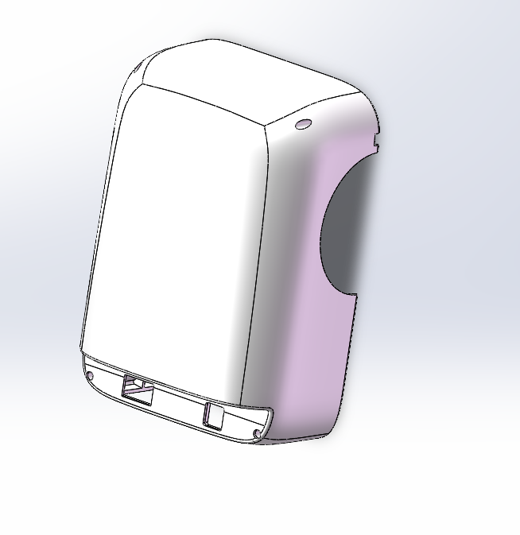 | [Part_01_Back_Torso_Shell.step](./3D_Printed_Parts/Part_01_Back_Torso_Shell.step) | — | 1 PCS | — |
| Head Eyes Assembly | 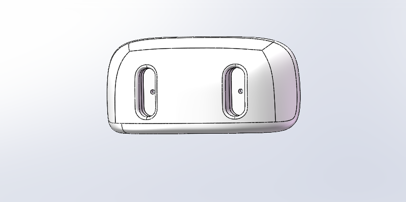 | [Part_01_Eyes.step](./3D_Printed_Parts/Part_01_Eyes.step) | — | 1 PCS | — |
| Head Eye Socket | 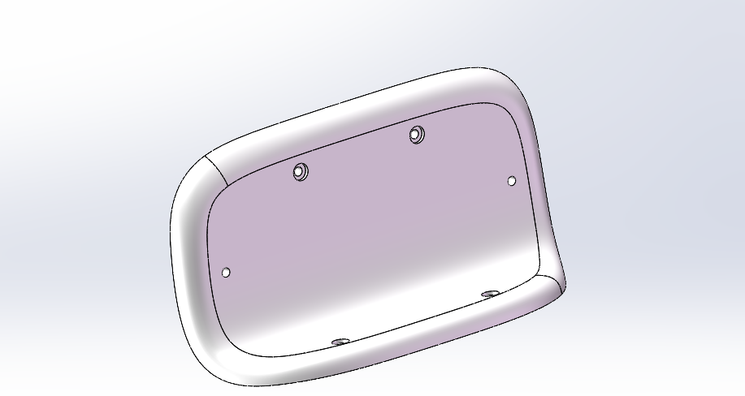 | [Part_01_Eye_Socket.step](./3D_Printed_Parts/Part_01_Eye_Socket.step) | SLA resin · blue | 1 PCS | — |
| Left Eye |  | [Part_01_Left_Eye.step](./3D_Printed_Parts/Part_01_Left_Eye.step) | SLA resin · black | 1 PCS | — |
| Right Eye |  | [Part_01_Right_Eye.step](./3D_Printed_Parts/Part_01_Right_Eye.step) | — | 1 pcs | — |
| Shoulder Shell A |  | [Part_01_Shoulder_Shell_A.step](./3D_Printed_Parts/Part_01_Shoulder_Shell_A.step) | SLA resin · blue | 4 PCS | — |
| Shoulder Shell B1 |  | [Part_01_Shoulder_Shell_B1.step](./3D_Printed_Parts/Part_01_Shoulder_Shell_B1.step) | SLA resin · white | 2 pcs | — |
| Left Shoulder Shell B2 |  | [Part_01_Left_Shoulder_Shell_B2.step](./3D_Printed_Parts/Part_01_Left_Shoulder_Shell_B2.step) | — | 1 pcs | — |
| Right Shoulder Shell B2 |  | [Part_01_Right_Shoulder_Shell_B2.step](./3D_Printed_Parts/Part_01_Right_Shoulder_Shell_B2.step) | — | 1 pcs | — |
| J2 Shell A |  | [Part_01_J2_Shell_A.step](./3D_Printed_Parts/Part_01_J2_Shell_A.step) | SLA resin · blue & white | 2 PCS | Sanded & masked-painted |
| Shell B |  | [Part_01_Shell_B.step](./3D_Printed_Parts/Part_01_Shell_B.step) | SLA resin · white | 2 PCS | Sanded & painted |
| Upper Arm Shell A |  | [Part_01_Upper_Arm_Shell_A.step](./3D_Printed_Parts/Part_01_Upper_Arm_Shell_A.step) | — | 2 pcs | — |
| Upper Arm Shell B |  | [Part_01_Upper_Arm_Shell_B.step](./3D_Printed_Parts/Part_01_Upper_Arm_Shell_B.step) | — | 2 pcs | — |
| J5 Shell A |  | [Part_01_J5_Shell_A.step](./3D_Printed_Parts/Part_01_J5_Shell_A.step) | — | 2 pcs | — |
| J5 Shell B |  | [Part_01_J5_Shell_B.step](./3D_Printed_Parts/Part_01_J5_Shell_B.step) | — | 2 pcs | — |
| J6 Shell A |  | [Part_01_J6_Shell_A.step](./3D_Printed_Parts/Part_01_J6_Shell_A.step) | SLA resin · blue & white | 2 pcs | Sanded & masked-painted |
| J6 Shell B |  | [Part_01_J6_Shell_B.step](./3D_Printed_Parts/Part_01_J6_Shell_B.step) | — | 2 pcs | — |
| J7 shell A |  | [Part_01_J7_shell_A.step](./3D_Printed_Parts/Part_01_J7_shell_A.step) | SLA resin · blue | 2 pcs | Sanded & painted |
| J7 shell B |  | [Part_01_J7_shell_B.step](./3D_Printed_Parts/Part_01_J7_shell_B.step) | — | 2 pcs | — |

### 🧩 Printing Recommendations
- Process: SLA / LCD resin printing, 0.05 mm layer height
- Cosmetic shells: sand, then paint (colors per table; masked two-tone where noted)
- Load-bearing brackets: PETG or PETG-CF may be substituted where appearance allows

---

## 🧵 FDM / Other Printed Parts

| Part Description | Image | File Name | Material | Qty | Notes |
|----------|------|--------|------|----------|------|
| J2 Cable Chase |  | [Part_02_J2_Cable_Chase.step](./Metal_Parts/Part_02_J2_Cable_Chase.step) | PETG · white (FDM) | 2 PCS | — |
| Link Joint2 Joint3 D |   | [Part_01_Link_Joint2_Joint3_D.step](./3D_Printed_Parts/Part_01_Link_Joint2_Joint3_D.step) |  | 2 PCS | — |
| Link Joint2 Joint3 E |   | [Part_01_Link_Joint2_Joint3_E.step](./3D_Printed_Parts/Part_01_Link_Joint2_Joint3_E.step) |  | 2 PCS | — |
| J3 Cable Route A |  | [Part_01_J3_Cable_Route_A.step](./3D_Printed_Parts/Part_01_J3_Cable_Route_A.step) | — | 2 PCS | — |
| J3 Cable Route B |  | [Part_01_J3_Cable_Route_B.step](./3D_Printed_Parts/Part_01_J3_Cable_Route_B.step) | — | 2 PCS | — |
| J6–J7 Cable Fixing Block |  | [Part_01_J6_J7_cable_fixing_block.step](./3D_Printed_Parts/Part_01_J6_J7_cable_fixing_block.step) | — | 2 PCS | — |
| Intel RealSense D405 Wrist Camera Mount |  | [Part_01_Realsense405_Mount.step](./3D_Printed_Parts/Part_01_Realsense405_Mount.step) | — | 2 PCS | — |
| J5 Clamping Block |  | [Part_01_J5_Cramping_block.step](./3D_Printed_Parts/Part_01_J5_Cramping_block.step) | — | 4 PCS | — |
| Intel RealSense D435 Head Camera Mount |  | [Part_01_D435_Mount.step](./3D_Printed_Parts/Part_01_D435_Mount.step) | — | 1 PCS | — |
| MCU Controller Mount |  | [Part_01_MCU_Contorler_Mount.step](./3D_Printed_Parts/Part_01_MCU_Contorler_Mount.step) | — | 1 PCS | — |
| Jetson Orin Mount |  | [Part_01_Orin_Mount.step](./3D_Printed_Parts/Part_01_Orin_Mount.step) | — | 1 PCS | — |
| HDMI Module Mount A |  | [Part_01_HDMI_Mount_A.step](./3D_Printed_Parts/Part_01_HDMI_Mount_A.step) | — | 1 PCS | — |
| HDMI Module Mount B |  | [Part_01_HDMI_Mount_B.step](./3D_Printed_Parts/Part_01_HDMI_Mount_B.step) | — | 1 PCS | — |

### 🧩 Printing Recommendations
- Layer height: 0.2 mm, nozzle: 0.4 mm
- Cable guides and non-cosmetic mounts: PETG or PETG-CF, 30%+ infill

---

## 🤏 Gripper Fingers

| Part Description | Image | File Name | Material | Qty | Notes |
|----------|------|--------|------|----------|------|
| Gripper Finger A (fixed) |  | [Part_02_Finger_A.step](./Metal_Parts/Part_02_Finger_A.step) | — | 4 PCS | — |
| Gripper Finger B (movable) |  | [Part_01_Finger_B.step](./3D_Printed_Parts/Part_01_Finger_B.step) | — | 4 PCS | Urethane cast (silicone mold) |

---

## 🛒 Purchased Standard Parts

> [!NOTE]
> Quantities below are totals for one complete dual-arm platform (two arms + torso) — always order spares. Taobao and Amazon links and prices were captured in 2026-11; Taobao prices are listing starting prices (they vary by size and quantity).

### Bearings & Linear Motion

| Part | Spec | Qty | File Name | Taobao Link | Amazon Link (ref. price) |
|----------|------|:---:|------|------|------|
| Deep-groove ball bearing (6806) | 30×42×7 | 2 | [Part_03_30x42x7_Bearing.step](./Purchased_Parts/Part_03_30x42x7_Bearing.step) | [¥16](https://item.taobao.com/item.htm?id=709383643059) | [$12.99 / 10 pcs](https://www.amazon.com/dp/B0GRRF5CQ6) |
| Ball bearing (6705) | 25×32×4 | 2 | [Part_03_Bearing_25x32x4.step](./Purchased_Parts/Part_03_Bearing_25x32x4.step) | [¥3](https://detail.tmall.com/item.htm?id=617257760826) | [$9.19 / 4 pcs](https://www.amazon.com/dp/B0CNX4XQWS) |
| Ball bearing (MR104) | 4×10×4 | 12 | [Part_03_Bearing_4-10-4.step](./Purchased_Parts/Part_03_Bearing_4-10-4.step) | [¥3.6](https://detail.tmall.com/item.htm?id=662290112665) | [$8.99 / 10 pcs](https://www.amazon.com/dp/B09DK3SQGR) |
| Rod-end bearing GE4C | GE4C | 8 | [Part_03_rod_end_bearing.step](./Purchased_Parts/Part_03_rod_end_bearing.step) | [¥1.93](https://detail.tmall.com/item.htm?id=677660355770) | [$17.89 / 1 pc](https://www.amazon.com/dp/B0FKY137B7) |
| Flanged bearing F6804ZZ | 20×32×7 | 2 | — | [¥4.2](https://item.taobao.com/item.htm?id=783625634054) | [$4.66 / 2 pcs](https://www.amazon.com/dp/B0CP48SK8N) |
| Flanged bearing F688ZZ | 8×16×5 | 2 | [Part_03_F688ZZ.step](./Purchased_Parts/Part_03_F688ZZ.step) | [¥0.85](https://item.taobao.com/item.htm?id=787436638716) | [$7.99 / 10 pcs](https://www.amazon.com/dp/B0CZNCXY5T) |
| Flanged bearing F6803ZZ | 17×26×5 | 2 | [Part_03_F6703ZZ.step](./Purchased_Parts/Part_03_F6703ZZ.step) | [¥4.2](https://item.taobao.com/item.htm?id=783625634054) | [$6.49 / 2 pcs](https://www.amazon.com/dp/B0CP485RPH) |
| Linear rail MGN9 (grippers use 150 mm) | MGN9 anti-rust rail | 2 | [Part_03_MGN9-163mm.step](./Purchased_Parts/Part_03_MGN9-163mm.step) | [¥3](https://item.taobao.com/item.htm?id=1054825865658) | [$17.89 / 150 mm rail + block](https://www.amazon.com/dp/B09SD9N2Q5) |
| MGN9C slide block | MGN9C standard block | 4 | — | [¥5](https://detail.tmall.com/item.htm?id=709992228016) | [$23.17](https://www.amazon.com/dp/B08ZS5S16W) |

### 🔩 Screw / Fastener BOM Summary

> [!NOTE]
> With 36 specifications and 558 pieces in total, screws are consolidated into this single category and **not broken down per joint**. Quantities are counted from the `03_Screws` fastener group of the full-assembly model (2026-11-14); codes match the component names in the assembly tree (HM = socket head cap / KM = countersunk / PM = button head / FM = flat head / DX = dowel pin / SS = shoulder / PW = Phillips w/ washer).
> Taobao and Amazon links and prices were captured in 2026-11; Taobao prices are listing starting prices.
> 💡 Buying one pack per spec at Amazon reference prices totals ≈ **$283**; most packs contain more pieces than the robot needs.

| No. | Type | Size / Spec | Code | Qty (pcs) | Taobao Link | Amazon Link |
| :---: | :--- | :--- | :--- | :---: | :--- | :--- |
| 1 | Socket Head Cap Screw | M2.5×12 | 03_HM2.5x12 | 1 | [¥1.12](https://item.taobao.com/item.htm?id=963493924490) | [$6.99](https://www.amazon.com/dp/B0CG29YCKW) |
| 2 | Socket Head Cap Screw | M2.5×20 | 03_HM2.5x20 | 24 | [¥1.7](https://item.taobao.com/item.htm?id=974509690514) | [$8.99 / 105 pcs](https://www.amazon.com/dp/B0CXQ3TVF2) |
| 3 | Socket Head Cap Screw | M3×8 | 03_HM3x8 | 24 | [¥1.12](https://item.taobao.com/item.htm?id=521228382978) | [$6.76 / 100 pcs](https://www.amazon.com/dp/B07CMQ1SQH) |
| 4 | Socket Head Cap Screw | M3×10 | 03_HM3x10 | 130 | [¥1.12](https://item.taobao.com/item.htm?id=521228382978) | [$6.99 / 50 pcs](https://www.amazon.com/dp/B0GH3QWSKV) |
| 5 | Socket Head Cap Screw | M3×12 | 03_HM3x12 | 9 | [¥1.12](https://item.taobao.com/item.htm?id=739797941952) | [$6.99 / 50 pcs](https://www.amazon.com/dp/B0GH4SV878) |
| 6 | Socket Head Cap Screw | M3×18 | 03_HM3x18 | 4 | [¥5.98](https://item.taobao.com/item.htm?id=918484403235) | [$6.99 / 100 pcs](https://www.amazon.com/dp/B07CMX3MCW) |
| 7 | Socket Head Cap Screw | M3×20 | 03_HM3x20 | 12 | [¥1.06](https://item.taobao.com/item.htm?id=894456862974) | [$8.99 / 180 pcs](https://www.amazon.com/dp/B0DJQHC7K9) |
| 8 | Socket Head Cap Screw | M4×8 | 03_HM4x8 | 16 | [¥5.98](https://item.taobao.com/item.htm?id=521228382978) | [$6.99 / 50 pcs](https://www.amazon.com/dp/B0GCSQ6F9Z) |
| 9 | Socket Head Cap Screw | M4×10 | 03_HM4x10 | 8 | [¥1.12](https://item.taobao.com/item.htm?id=788815662638) | [$6.99 / 50 pcs](https://www.amazon.com/dp/B0GCSJR229) |
| 10 | Socket Head Cap Screw | M4×12 | 03_HM4x12 | 20 | [¥1.06](https://item.taobao.com/item.htm?id=788815662638) | [$8.99 / 120 pcs](https://www.amazon.com/dp/B0DYMS1VVC) |
| 11 | Socket Head Cap Screw | M4×15 | 03_HM4x15 | 44 | [¥5.98](https://item.taobao.com/item.htm?id=963493924490) | [$7.29](https://www.amazon.com/dp/B0CG28M5HK) |
| 12 | Socket Head Cap Screw | M4×20 | 03_HM4x20 | 4 | [¥1.06](https://item.taobao.com/item.htm?id=521228382978) | [$7.99 / 50 pcs](https://www.amazon.com/dp/B0GH629T8X) |
| 13 | Socket Head Cap Screw | M8×12 | 03_HM8x12 | 8 | [¥5.98](https://item.taobao.com/item.htm?id=830203292518) | [$13.99](https://www.amazon.com/dp/B0BHLZJWK6) |
| 14 | Socket Countersunk Head Screw | M3×8 | 03_KM3x8 | 2 | [¥3.6](https://item.taobao.com/item.htm?id=993726910144) | [$6.49](https://www.amazon.com/dp/B01D8L4XVE) |
| 15 | Socket Countersunk Head Screw | M3×10 | 03_KM3x10 | 6 | [¥3.6](https://detail.tmall.com/item.htm?id=960239468310) | [$8.99](https://www.amazon.com/dp/B08HNF3J3D) |
| 16 | Socket Countersunk Head Screw | M3×16 | 03_KM3x16 | 16 | [¥3.6](https://detail.tmall.com/item.htm?id=693391661520) | [$6.39 / 100 pcs](https://www.amazon.com/dp/B0CQ4YS4CR) |
| 17 | Socket Countersunk Head Screw | M3×20 | 03_KM3x20 | 6 | [¥1.5](https://detail.tmall.com/item.htm?id=693391661520) | [$8.99 / 100 pcs](https://www.amazon.com/dp/B0GDWH9DZK) |
| 18 | Socket Countersunk Head Screw | M4×8 | 03_KM4x8 | 12 | [¥3.96](https://detail.tmall.com/item.htm?id=693391661520) | [$7.49 / 50 pcs](https://www.amazon.com/dp/B0H7WNNXG4) |
| 19 | Socket Countersunk Head Screw | M4×16 | 03_KM4x16 | 4 | [¥2.15](https://detail.tmall.com/item.htm?id=693391661520) | [$8.99](https://www.amazon.com/dp/B08P5LTXN1) |
| 20 | Socket Button Head Screw | M3×10 | 03_PM3x10 | 8 | [¥1.7](https://item.taobao.com/item.htm?id=638405691603) | [$7.69 / 100 pcs](https://www.amazon.com/dp/B0GH67N6D6) |
| 21 | Socket Button Head Screw | M3×22 | 03_PM3x22 | 16 | [¥0.29](https://item.taobao.com/item.htm?id=40344704723) | [$14.39](https://www.amazon.com/dp/B01B1ODKWS) |
| 22 | Socket Button Head Screw | M4×8 | 03_PM4x8 | 10 | [¥1.7](https://detail.tmall.com/item.htm?id=622200135746) | [$8.99](https://www.amazon.com/dp/B09ZH4TFPC) |
| 23 | Socket Button Head Screw | M4×10 | 03_PM4x10 | 14 | [¥1.7](https://item.taobao.com/item.htm?id=751159860192) | [$7.99 / 50 pcs](https://www.amazon.com/dp/B0GGGDWNFL) |
| 24 | Socket Button Head Screw | M4×12 | 03_PM4x12 | 12 | [¥1.7](https://item.taobao.com/item.htm?id=712350081913) | [$7.99 / 50 pcs](https://www.amazon.com/dp/B0GJHXFBPP) |
| 25 | Socket Button Head Screw | M4×15 | 03_PM4x15 | 16 | [¥1.7](https://detail.tmall.com/item.htm?id=585902280402) | [$7.99 / 105 pcs (M4×16 approx.)](https://www.amazon.com/dp/B0DJMYLXBG) |
| 26 | Socket Flat Head Screw | M3×8 | 03_FM3x8 | 38 | [¥0.23](https://item.taobao.com/item.htm?id=1060954762230) | [$7.99](https://www.amazon.com/dp/B09HS9GMG3) |
| 27 | Socket Flat Head Screw | M3×12 | 03_FM3x12 | 6 | [¥0.23](https://detail.tmall.com/item.htm?id=693391661520) | [$9.49 / multi-size kit (incl. M3×12)](https://www.amazon.com/dp/B0CZQRM3QH) |
| 28 | Socket Flat Head Screw | M3×14 | 03_FM3x14 | 2 | [¥1.85](https://detail.tmall.com/item.htm?id=693391661520) | [$6.99](https://www.amazon.com/dp/B0CG1PW698) |
| 29 | Socket Flat Head Screw | M3×16 | 03_FM3x16 | 10 | [¥1.38](https://item.taobao.com/item.htm?id=40257027484) | [$6.39 / 100 pcs](https://www.amazon.com/dp/B0CQ4YS4CR) |
| 30 | Socket Flat Head Screw | M3×20 | 03_FM3x20 | 12 | [¥1.5](https://detail.tmall.com/item.htm?id=693391661520) | [$9.49](https://www.amazon.com/dp/B0CZR9BD83) |
| 31 | Socket Flat Head Screw | M5×12 | 03_FM5x12 | 16 | [¥1.83](https://detail.tmall.com/item.htm?id=693391661520) | [$5.99 / 25 pcs](https://www.amazon.com/dp/B0G19G1RC7) |
| 32 | Dowel Pin | Φ3×6 | 03_DX3x6 | 12 | [¥0.04](https://item.taobao.com/item.htm?id=751868311463) | [$5.99 / 60 pcs](https://www.amazon.com/dp/B0DZ22L7BL) |
| 33 | Dowel Pin | Φ4×6 | 03_DX4x6 | 18 | [¥0.04](https://item.taobao.com/item.htm?id=751868311463) | [$5.19 / 50 pcs](https://www.amazon.com/dp/B0DYSV19YB) |
| 34 | Dowel Pin | Φ4×8 | 03_DX4x8 | 6 | [¥0.04](https://item.taobao.com/item.htm?id=920605573925) | [$6.69 / 55 pcs](https://www.amazon.com/dp/B0FW3VDGRQ) |
| 35 | Shoulder Screw | d4×6×M3 | 03_shoulder_screw_d4x6xM3 | 4 | [¥1.6](https://item.taobao.com/item.htm?id=752230143589) | [$7.40 / 26 pcs](https://www.amazon.com/dp/B0FDPV2411) |
| 36 | Phillips Screw w/ Washer | M2×4×6 | 03_PM2x4x6 | 8 | [¥1.5](https://item.taobao.com/item.htm?id=40233527435) | [$3.99 / 981 pcs (M2 kit, approx.)](https://www.amazon.com/dp/B0GCGVJ1JQ) |
| **TOTAL** | **36 specs** |  |  | **558** |  |  |

**Summary by type**

| Type | Prefix | Specs | Qty (pcs) |
| :--- | :---: | :---: | :---: |
| Socket Head Cap Screw | HM | 13 | 304 |
| Socket Countersunk Head Screw | KM | 6 | 46 |
| Socket Button Head Screw | PM | 6 | 76 |
| Socket Flat Head Screw | FM | 6 | 84 |
| Dowel Pin | DX | 3 | 36 |
| Shoulder Screw | SS | 1 | 4 |
| Phillips Screw w/ Washer | PW | 1 | 8 |
| **TOTAL** |  | **36** | **558** |

### Other Standard Parts

| Part | Spec | Qty | File Name | Taobao Link | Amazon Link (ref. price) |
|----------|------|:---:|------|------|------|
| Hex brass standoff | M3×14 double-pass | 32 | — | [¥2.55](https://detail.tmall.com/item.htm?id=1071230029834) | [$8.99 / 25 pcs (M3×15 approx.)](https://www.amazon.com/dp/B015A3LHL2) |
| Hex brass standoff | M3×8 double-pass | 8 | — | [¥0.07](https://detail.tmall.com/item.htm?id=1070165098977) | [$5.15 / 100 pcs](https://www.amazon.com/dp/B09L5L4DP7) |
| G-clamp, 2-inch (clamps up to 58 mm) | — | 2 | — | [¥2](https://item.taobao.com/item.htm?id=521150294712) | [$12.29 / 2 pcs](https://www.amazon.com/dp/B0CRVGVJQ1) |
| Shoulder screw 4×6×M3 (variant) | d4×6×M3 | 4 | [Part_03_shoulder_screw4x6xM3.step](./Purchased_Parts/Part_03_shoulder_screw4x6xM3.step) | [¥1.6](https://item.taobao.com/item.htm?id=752230143589) | [$7.40 / 26 pcs](https://www.amazon.com/dp/B0FDPV2411) |

### Sensors (Cameras)

| Part | Model | Qty | File Name | Official Store (Seeed) | Amazon Link (ref. price) |
|----------|------|:---:|------|------|------|
| Intel RealSense D405 depth camera (wrist) | D405 | 2 | [Part_03_RealSense_D405.step](./Purchased_Parts/Part_03_RealSense_D405.step) | [Seeed Studio](https://www.seeedstudio.com/RealSense-D405-3D-Camera-p-6758.html) | [$444.00](https://www.amazon.com/dp/B0H357JD93) |
| Intel RealSense D435i depth camera (head) | D435i | 1 | [Part_03_RealSense_D435.step](./Purchased_Parts/Part_03_RealSense_D435.step) | [Seeed Studio](https://www.seeedstudio.com/Intel-RealSense-Depth-Camera-D435i-p-4423.html) | [$559.99](https://www.amazon.com/dp/B07MWR2YJB) |

---

## 🧠 Controller

| Part Description | File Name | Qty | Notes |
|----------|--------|:---:|------|
| UniBox 7-CAN controller board (V1.2) | [Part_03_MCU_Controler.step](./Purchased_Parts/Part_03_MCU_Controler.step) | 1 PCS | Power + CAN-bus distribution for both arms |

The UniBox 7-CAN board distributes power and CAN bus to the joint actuators; wiring for both arms and the grippers runs through the torso.

---

## 🔌 Wiring Harnesses

All harnesses are **custom fabrication** (XT30 2+2 power+CAN daisy-chains between joints).

| Harness | Connector / Cable | Qty | Notes |
|----------|------|:---:|------|
| Power input | XT30(2+2), one right-angle + one straight, gray flat cable, 320 mm | 2 PCS | Main power feed |
| J1–J2 | XT30(2+2), right-angle both ends, red/black, 300 mm, 120 mm braided sleeve, glued strain relief | 2 PCS | Shoulder harness |
| J2–J3 | XT30(2+2), right-angle both ends, gray round cable, 120 mm | 2 PCS | — |
| J3–J4 | XT30(2+2), right-angle both ends, red/black, 190 mm | 2 PCS | — |
| J4–J5 | XT30(2+2), double right-angle, red/black, 240 mm, 160 mm braided sleeve | 2 PCS | — |
| J5–J6 | XT30(2+2), double right-angle, red/black, 100 mm | 2 PCS | — |
| J6–J7 | XT30(2+2) — length per source BOM | 2 PCS | — |

---

## 🏷️ License

Hardware design © 2026 Seeed Studio Co., Ltd. — open sourced under [CERN-OHL-W-2.0](https://ohwr.org/cern_ohl_w_v2.txt). See the [repository LICENSE](../../LICENSE).
