# 🤖 reBot Arm T701 — 开源硬件规格说明

  

  <strong>
    <a href="./README_zh.md">简体中文</a> &nbsp;|&nbsp;
    <a href="./README.md">English</a>
  </strong>

| 日期 | 版本 | 文件名 | 更新说明 |
|----------|------|----------|------|
| 2026-10-20 | v1.0 | reBot_T701_v1.0_20261020.step | 首次发布：整机装配 STEP、98 个零件 STEP 文件、含参考图的完整 BOM |

这是 **reBot Arm T701**（SeeedStudio面向 Physical AI 的双臂机器人平台）的开源硬件资料包。除特别说明外，下表数量均为 **一整台 T701**（躯干 + 两条 7 自由度手臂 + 两个夹爪）的总数量。

# 📦 文件结构
*   **3D_Printed_Parts/**：全部打印件 / 复模件的 STEP 文件（光固化外壳、PETG 支架、夹爪手指等）。
*   **Metal_Parts/**：全部 CNC 加工件与钣金件的 STEP 文件。
*   **Purchased_Parts/**：外购物料的 STEP 模型（关节电机、轴承、导轨、紧固件、相机、控制板）。
*   **reBot_T701_v1.0_20261020.step**：双臂整机装配模型（约 200 MB，使用 Git LFS 存储，见仓库根目录 README）。

# 🛒 获取零件
整机购买渠道：

| 渠道 | 适用地区 | 购买链接 |
| :--- | :--- | :--- |
| Seeed Studio | 全球 | [reBot Arm T701](https://www.seeedstudio.com/reBot-Arm-T701-HT-p-7044.html) |
| 天猫旗舰店 | 中国大陆 | [reBot Arm T701](https://detail.tmall.com/item.htm?id=1097802431280) |
| 京东旗舰店 | 中国大陆 | [reBot Arm T701](https://item.jd.com/10239223747089.html) |

- 也可以按照下方 BOM 自行采购、加工全部零件。

# 📊 物料清单（BOM）

> [!WARNING]
> 公开的 BOM 为开源 v1.0 版本，面向开发者以合理成本复现做了优化，省略了部分非必要细节。Seeed 最终量产版本会针对工厂一致性调整公差、表面处理与走线，机械结构保持一致。

## 💰 成本估算（2026-11 参考）

| 类目 | 国际参考（USD） | 国内参考（CNY） | 说明 |
| :--- | :---: | :---: | :--- |
| CNC 加工件 | ≈ $300 | ≈ ¥2,010 | 内部加工估价 |
| 钣金件 | ≈ $500 | ≈ ¥3,350 | 内部加工估价 |
| 光固化打印件 | ≈ $200 | ≈ ¥1,340 | 打印材料与加工估价 |
| FDM / 其他打印件 | ≈ $50 | ≈ ¥335 | 打印材料估价 |
| 夹爪手指（复模） | ≈ $30 | ≈ ¥201 | 复模加工估价 |
| 关节电机 ×16 | ≈ $3,666 | ≈ ¥24,562 | Seeed 单价 × 数量（7256 DNE $309/台 与 5047 $200/台 为预估价，商城尚未上架） |
| 螺丝 / 紧固件（36 种规格） | ≈ $283 | ≈ ¥72 | 国际按每规格一包（Amazon）；国内为淘宝起售价合计 |
| 标准采购件（轴承/导轨/螺柱/夹具） | ≈ $143 | ≈ ¥48 | Amazon 参考价 / 淘宝起售价合计 |
| 传感器（D405 ×2 + D435i ×1） | ≈ $1,448 | ≈ ¥9,702 | Amazon 参考价 |
| **整机硬件合计** | **≈ $6,620** | **≈ ¥41,620** | 不含线束定制与 UniBox 7-CAN 控制板 |

> 价格采集于 2026-11（Amazon / Seeed / 淘宝），**随不同厂家与市场行情有所波动**，仅供预算参考。国内参考按 1 USD ≈ 6.7 CNY 折算（螺丝与标准件按淘宝实际价）；国内渠道采购标准件与螺丝通常明显低于国际参考价。

---

## ⚙️ CNC 加工件

| 零件描述 | 参考图 | 文件名 | 材质 / 处理 | 数量 | 备注 |
|----------|------|--------|------|----------|------|
| Shoulder Mounting Flange | 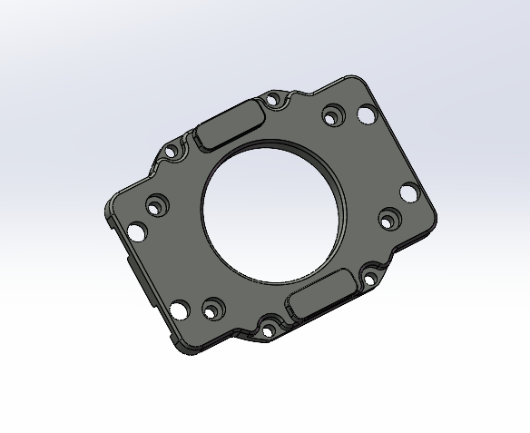 | [Part_02_Shoulder_Mounting_Flange.step](./Metal_Parts/Part_02_Shoulder_Mounting_Flange.step) | CNC/6061铝合金/阳极氧化哑光原色 | 2 PCS | — |
| Joint 1 Limit Block | 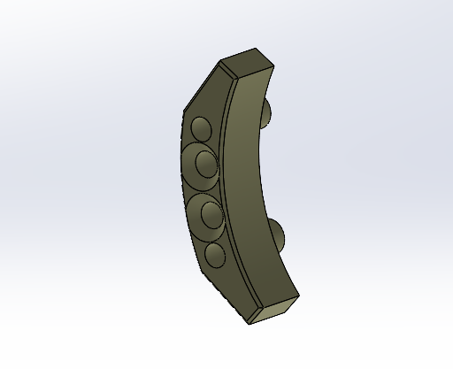 | [Part_02_Joint_1_Limit_Block.step](./Metal_Parts/Part_02_Joint_1_Limit_Block.step) | CNC/6061铝合金/阳极氧化哑光原色 | 2 PCS | — |
| Link Joint1 Joint2 | 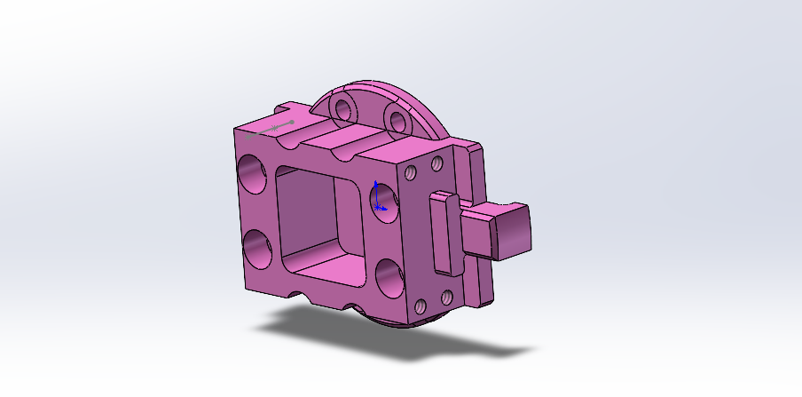 | [Part_02_Link_Joint1_Joint2.step](./Metal_Parts/Part_02_Link_Joint1_Joint2.step) | CNC/6061铝合金/阳极氧化哑光原色 | 2 PCS | — |
| Joint2 Mount A | 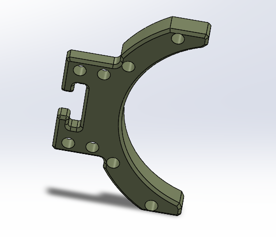 | [Part_02_Joint2_Mount_A.step](./Metal_Parts/Part_02_Joint2_Mount_A.step) | CNC/6061铝合金/阳极氧化哑光原色 | 2 PCS | — |
| Joint2 Mount B | 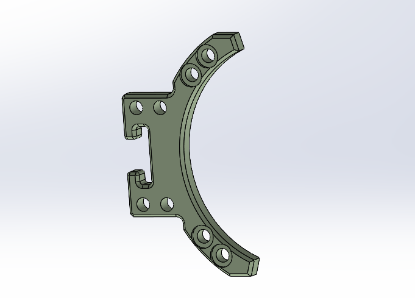 | [Part_02_Joint2_Mount_B.step](./Metal_Parts/Part_02_Joint2_Mount_B.step) | CNC/6061铝合金/阳极氧化哑光原色 | 2 PCS | — |
| Link Joint2 Joint3 A | 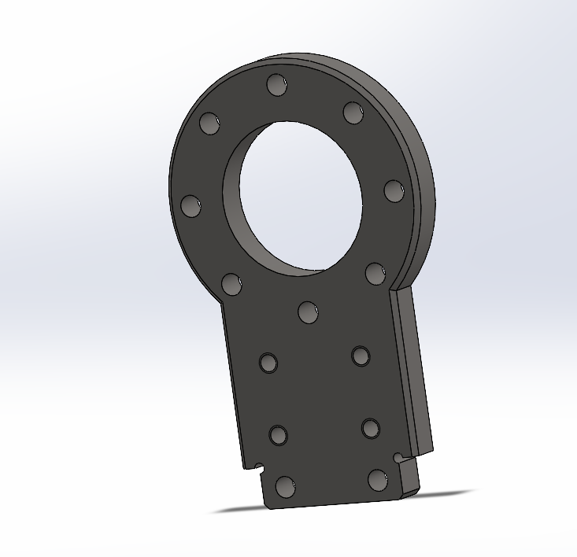 | [Part_02_Link_Joint2_Joint3_A.step](./Metal_Parts/Part_02_Link_Joint2_Joint3_A.step) | CNC/6061铝合金/阳极氧化哑光原色 | 2 PCS | — |
| Link Joint2 Joint3 B | 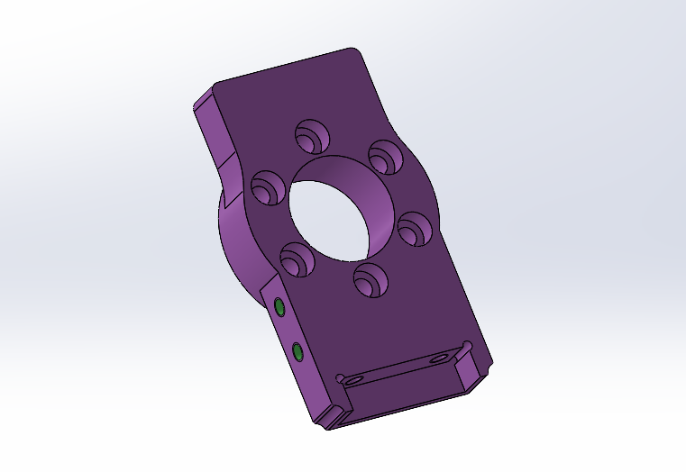 | [Part_02_Link_Joint2_Joint3_B.step](./Metal_Parts/Part_02_Link_Joint2_Joint3_B.step) | CNC/6061铝合金/阳极氧化哑光原色 | 2 PCS | — |
| J6 link output flange | 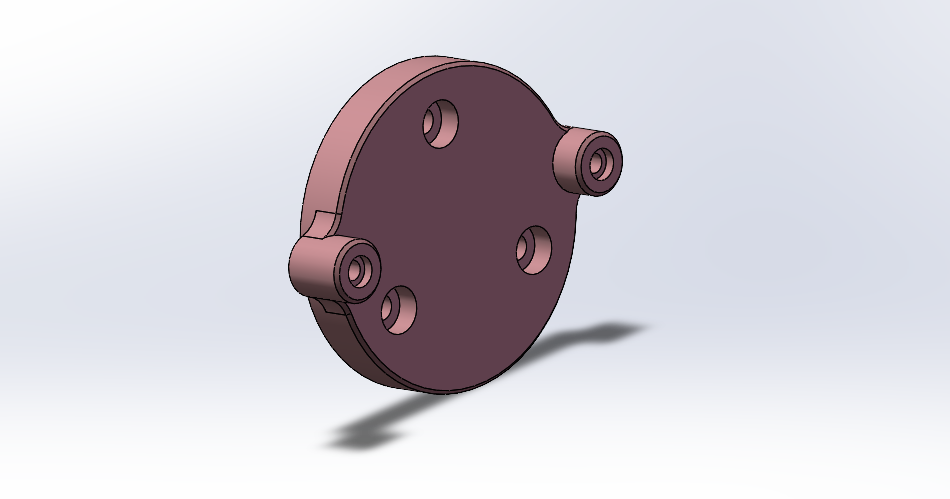 | [Part_02_J6_link_output_flange.step](./Metal_Parts/Part_02_J6_link_output_flange.step) | CNC/6061铝合金/阳极氧化哑光原色 | 2 PCS | — |
| wrist link A | 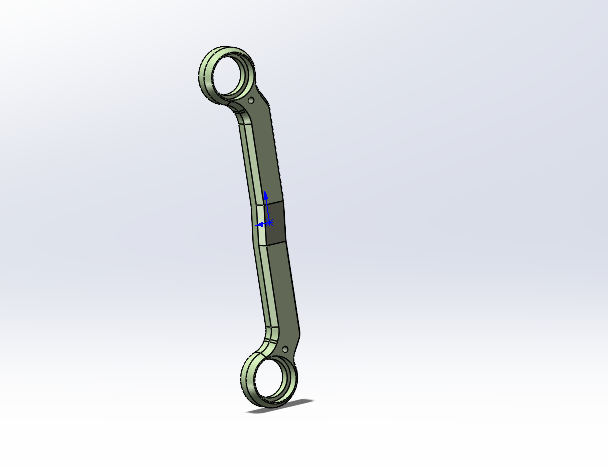 | [Part_02_wrist_link_A.step](./Metal_Parts/Part_02_wrist_link_A.step) | CNC/7075-0/阳极氧化哑光原色 | 2 PCS | — |
| wrist link B | 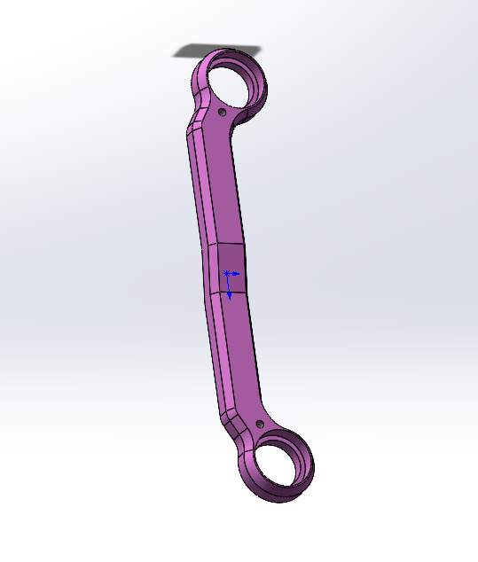 | [Part_02_wrist_link_B.step](./Metal_Parts/Part_02_wrist_link_B.step) | CNC/6061铝合金/阳极氧化哑光原色 | 2 PCS | — |
| Bearing Mount B | 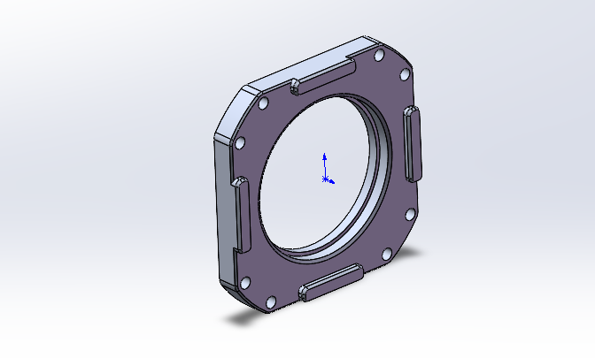 | [Part_02_Bearing_Mount_B.step](./Metal_Parts/Part_02_Bearing_Mount_B.step) | CNC/6061铝合金/阳极氧化哑光原色 | 2 PCS | — |
| Bearing Mount A | 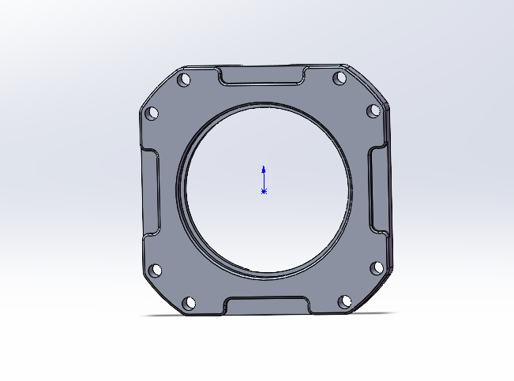 | [Part_02_Bearing_Mount_A.step](./Metal_Parts/Part_02_Bearing_Mount_A.step) | CNC/6061铝合金/阳极氧化哑光原色 | 2 PCS | — |
| J4 Coupling D | 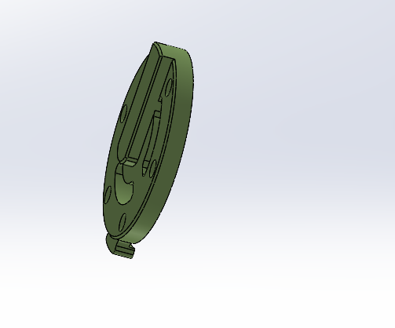 | [Part_02_J4_Coupling_D.step](./Metal_Parts/Part_02_J4_Coupling_D.step) | CNC/6061铝合金/阳极氧化哑光原色 | 2 PCS | — |
| J5 Joint limit | 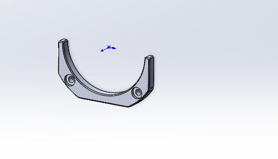 | [Part_02_J5_Joint_limit.step](./Metal_Parts/Part_02_J5_Joint_limit.step) | CNC/6061铝合金/阳极氧化哑光原色 | 2 PCS | — |
| J5 Coupling | 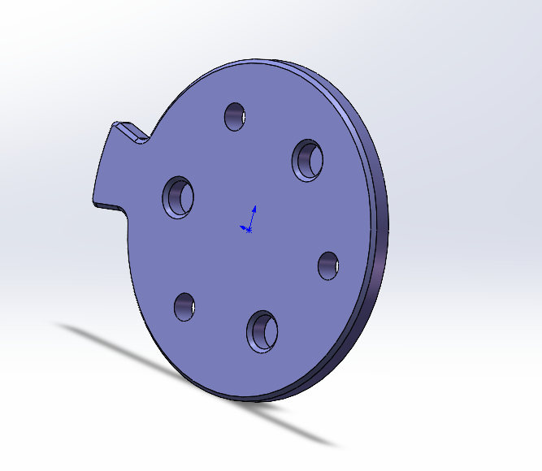 | [Part_02_J5_Coupling.step](./Metal_Parts/Part_02_J5_Coupling.step) | CNC/6061铝合金/阳极氧化哑光原色 | 2 PCS | — |
| J7 flange A | 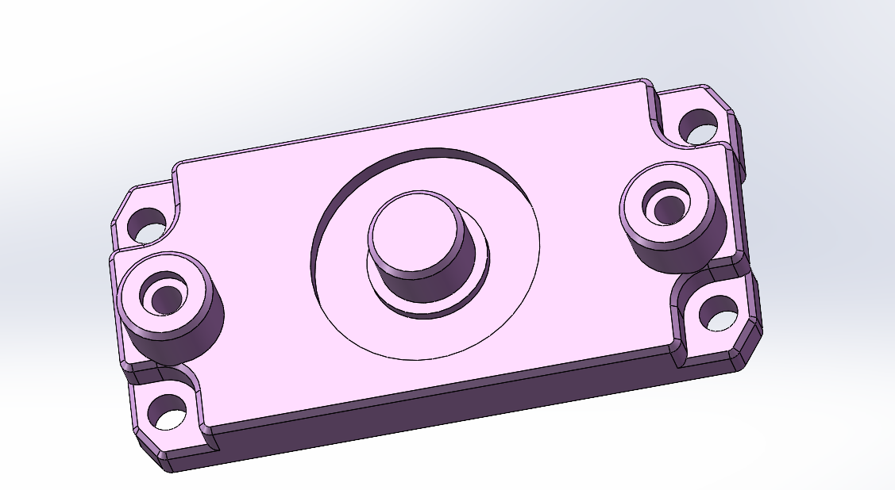 | [Part_02_J7_flange_A.step](./Metal_Parts/Part_02_J7_flange_A.step) | CNC/6061铝合金/150目喷砂/阳极氧化哑光黑 | 2 PCS | — |
| J7 output side flange | 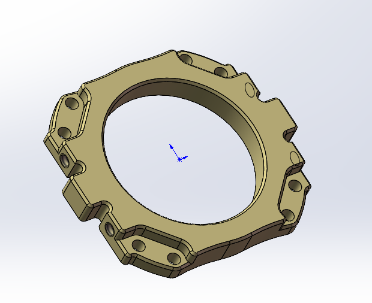 | [Part_02_J7_output_side_flange.step](./Metal_Parts/Part_02_J7_output_side_flange.step) | CNC/6061铝合金/150目喷砂/阳极氧化哑光黑 | 2 PCS | — |
| J7 bearing bracket A | 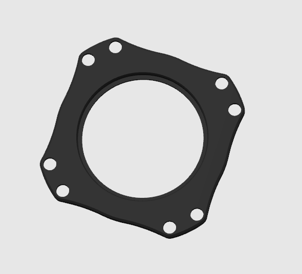 | [Part_02_J7_bearing_bracket_A.step](./Metal_Parts/Part_02_J7_bearing_bracket_A.step) | CNC/6061铝合金/150目喷砂/阳极氧化哑光黑 | 2 PCS | — |
| J7 bearing bracket B | 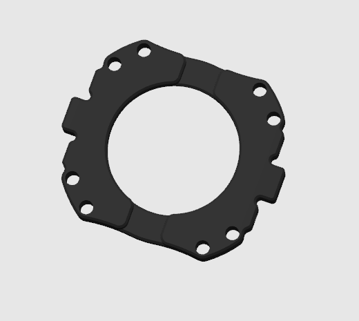 | [Part_02_J7_bearing_bracket_B.step](./Metal_Parts/Part_02_J7_bearing_bracket_B.step) | CNC/6061铝合金/150目喷砂/阳极氧化哑光黑 | 2 PCS | — |
| J7 bearing bracket C | 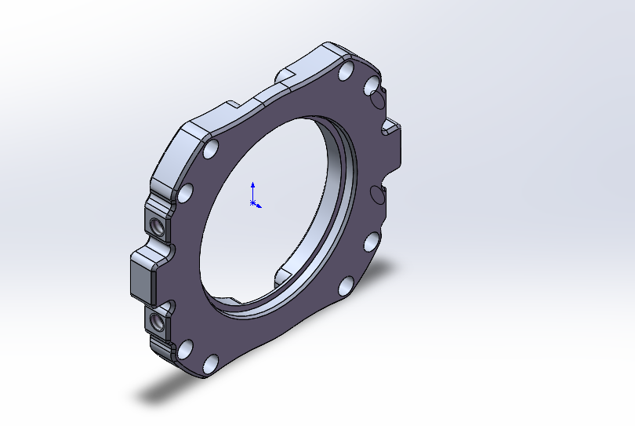 | [Part_02_J7_bearing_bracket_C.step](./Metal_Parts/Part_02_J7_bearing_bracket_C.step) | CNC/6061铝合金/150目喷砂/阳极氧化哑光黑 | 2 PCS | — |
| J7 bearing bracket D | 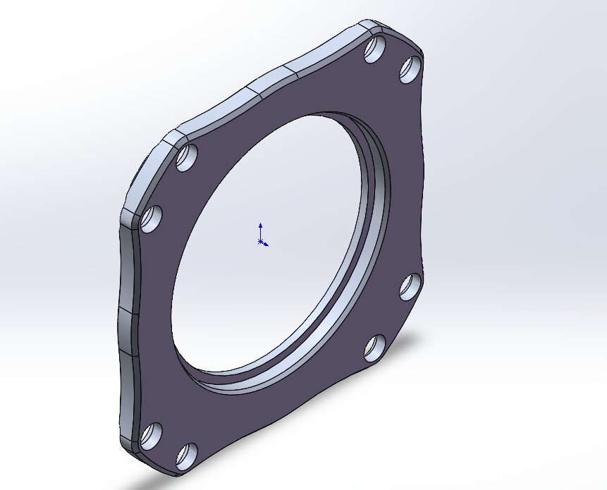 | [Part_02_J7_bearing_bracket_D.step](./Metal_Parts/Part_02_J7_bearing_bracket_D.step) | CNC/6061铝合金/150目喷砂/阳极氧化哑光黑 | 2 PCS | — |
| J7 Output side shim | 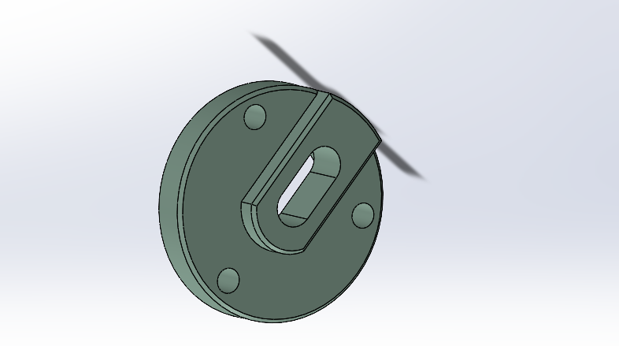 | [Part_02_J7_Output_side_shim.step](./Metal_Parts/Part_02_J7_Output_side_shim.step) | CNC/6061铝合金/150目喷砂/阳极氧化哑光黑 | 2 PCS | — |
| J7 flange B | 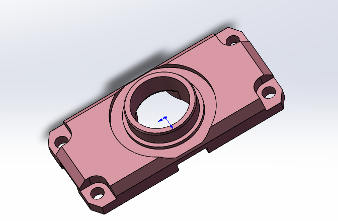 | [Part_02_J7_flange_B.step](./Metal_Parts/Part_02_J7_flange_B.step) | CNC/6061铝合金/150目喷砂/阳极氧化哑光黑 | 2 PCS | — |
| J8 Grippter Mount | 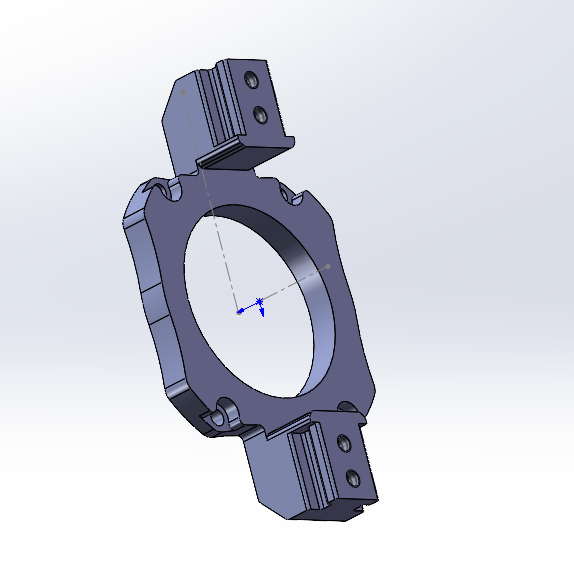 | [Part_02_J8_Grippter_Mount.step](./Metal_Parts/Part_02_J8_Grippter_Mount.step) | CNC/6061铝合金/150目喷砂/阳极氧化哑光黑 | 2 PCS | — |
| Claw link A | 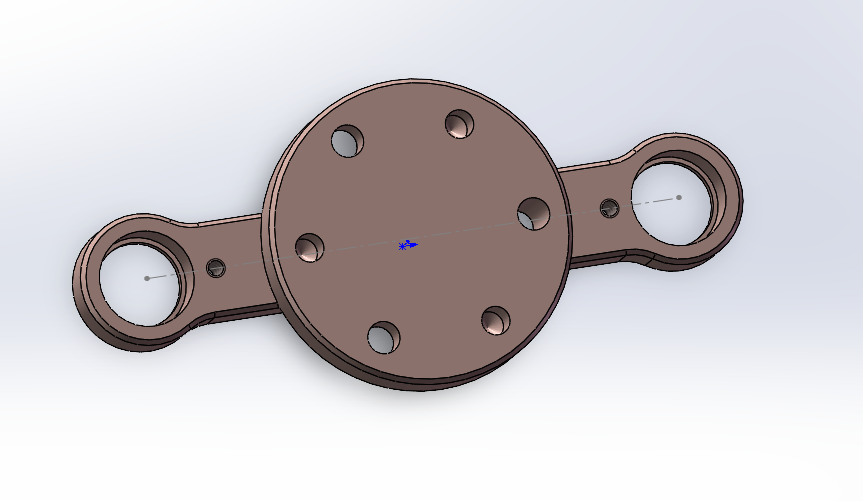 | [Part_02_Claw_link_A.step](./Metal_Parts/Part_02_Claw_link_A.step) | CNC/6061铝合金/150目喷砂/阳极氧化哑光黑 | 2 PCS | — |
| Slide connector | 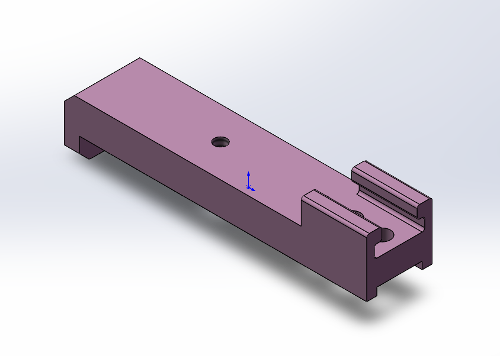 | [Part_02_Slide_connector.step](./Metal_Parts/Part_02_Slide_connector.step) | CNC/6061铝合金/150目喷砂/阳极氧化哑光黑 | 4 PCS | — |
| Claw link B | 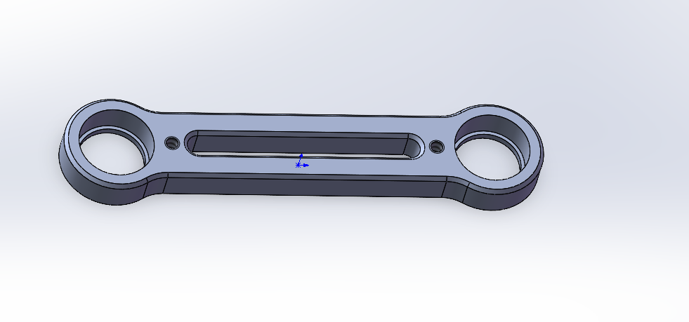 | [Part_02_Claw_link_B.step](./Metal_Parts/Part_02_Claw_link_B.step) | CNC/6061铝合金/150目喷砂/阳极氧化哑光黑 | 4 PCS | — |
| 夹爪连杆连接件 | 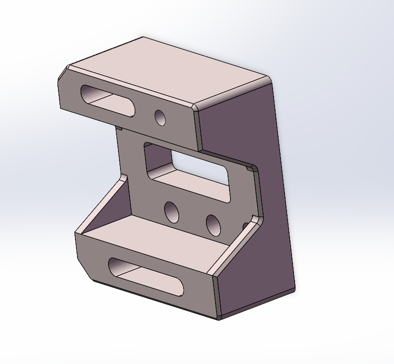 | [Part_02_Claw_Connector_B.step](./Metal_Parts/Part_02_Claw_Connector_B.step) | CNC/6061铝合金/150目喷砂/阳极氧化哑光黑 | 4 PCS | — |
| J4 Coupling A | 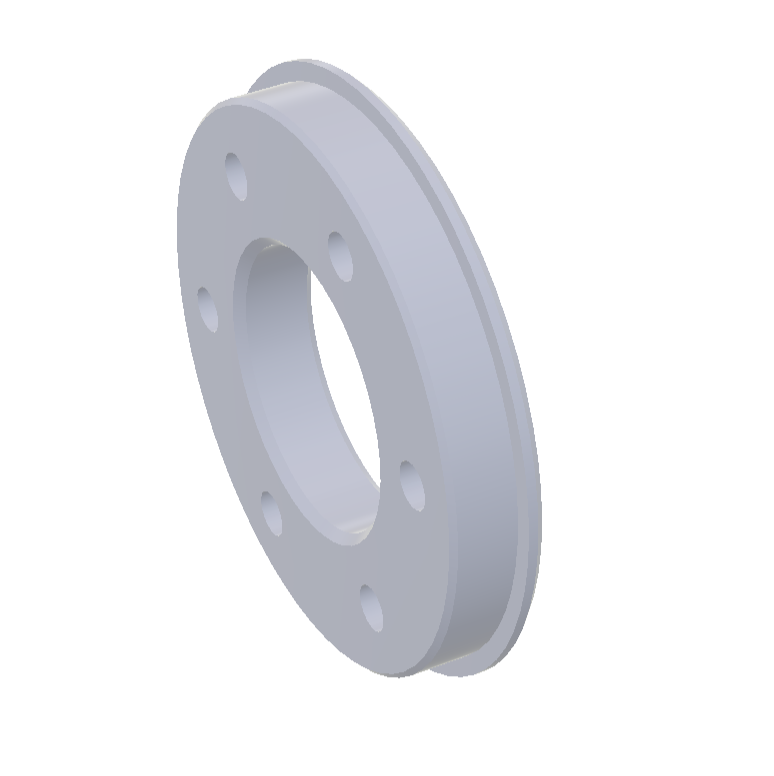 | [Part_02_J4_Coupling_A.step](./Metal_Parts/Part_02_J4_Coupling_A.step) | CNC/6061铝合金/150目喷砂/阳极氧化哑光黑 | 2 PCS | — |
| J4 Coupling B | 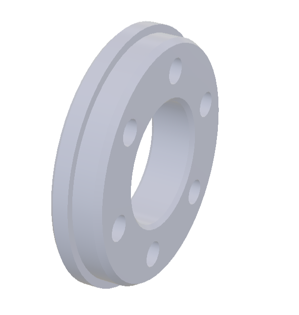| [Part_02_J4_Coupling_B.step](./Metal_Parts/Part_02_J4_Coupling_B.step) | CNC/6061铝合金/150目喷砂/阳极氧化哑光黑 | 2 PCS | — |
| J4 Coupling C | 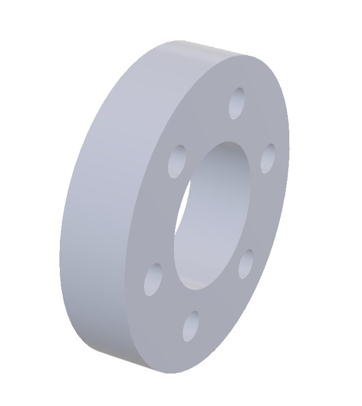| [Part_02_J4_Coupling_C.step](./Metal_Parts/Part_02_J4_Coupling_C.step) | CNC/6061铝合金/150目喷砂/阳极氧化哑光黑 | 2 PCS | — |

### 🧩 加工规格
- 铝合金：6061（结构连杆与支架）、7075（高负载腕部连杆）
- 关键尺寸公差：±0.02 mm
- 表面处理：150 目喷砂 + 哑光阳极氧化（原色 / 黑色见表格）

---

## 🔩 钣金件

| 零件描述 | 参考图 | 文件名 | 材质 / 处理 | 数量 | 备注 |
|----------|------|--------|------|----------|------|
| Link Joint2 Joint3 C | 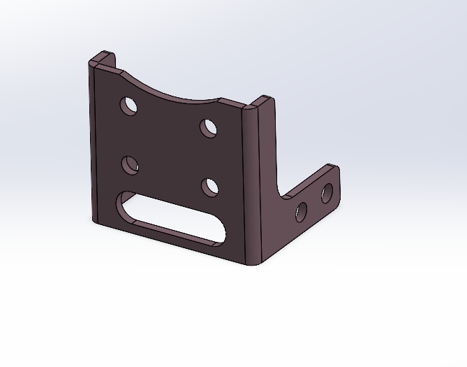 | [Part_02_Link_Joint2_Joint3_C.step](./Metal_Parts/Part_02_Link_Joint2_Joint3_C.step) | 钣金/铝合金-5052 / 普通阳极氧化-银色-哑光 | 2 PCS | 喷砂#150,阳极氧化（银色哑光，厚度≥15um） |
| 上臂框架（左/右） | 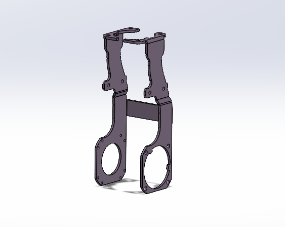 | [Part_02_Upper_arm_frame.step](./Metal_Parts/Part_02_Upper_arm_frame.step) [Part_02_Right_Upper_arm_frame.step](./Metal_Parts/Part_02_Right_Upper_arm_frame.step) | 钣金/铝合金-5052 / 普通阳极氧化-银色-哑光 | 1 PCS | — |
| J3 Motor Support Bracket | 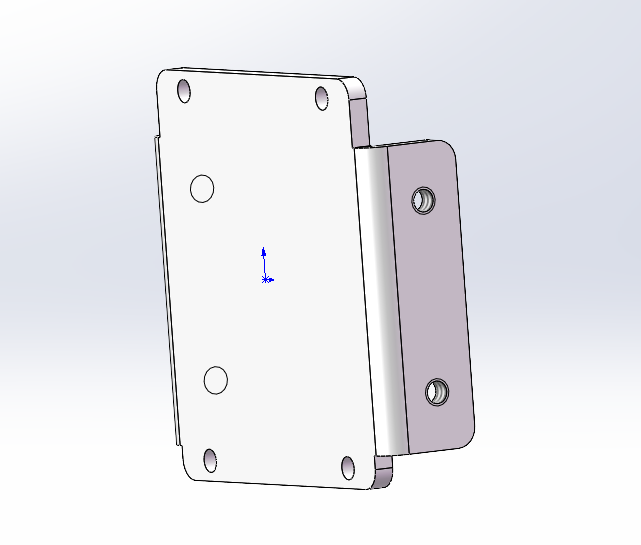 | [Part_02_J3_Motor_Support_Bracket.step](./Metal_Parts/Part_02_J3_Motor_Support_Bracket.step) | 钣金/铝合金-5052 / 普通阳极氧化-银色-哑光 | 2 PCS | — |
| Left Lower Frame A | 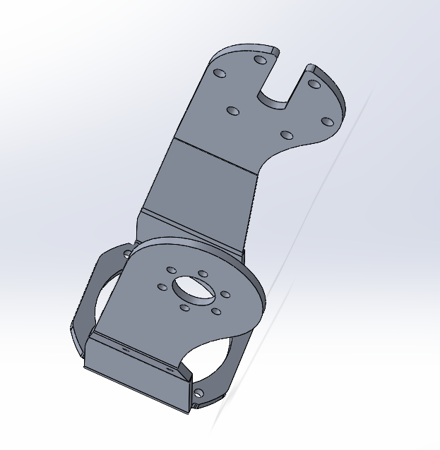 | [Part_02_Left_Lower_Frame_A.step](./Metal_Parts/Part_02_Left_Lower_Frame_A.step) | 钣金/铝合金-5052 / 普通阳极氧化-银色-哑光 | 1 PCS | — |
| Right Lower Frame A | 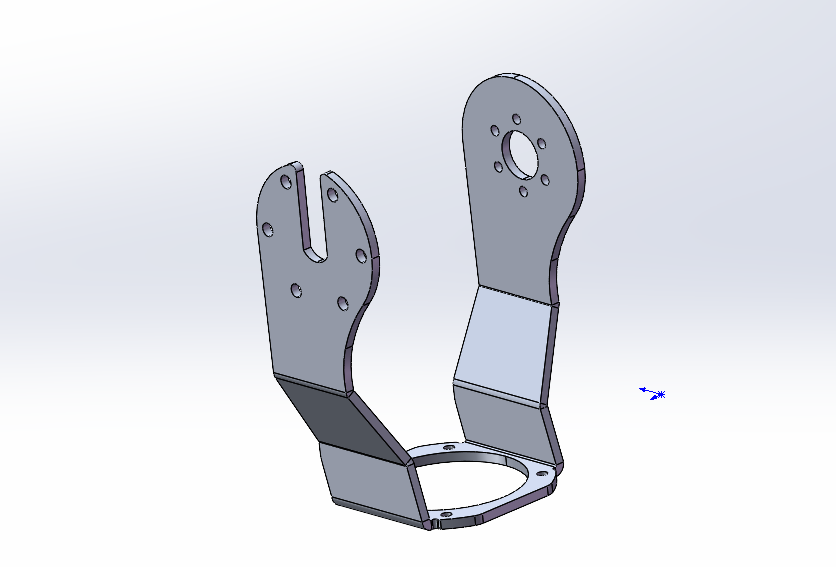 | [Part_02_Right_Lower_Frame_A.step](./Metal_Parts/Part_02_Right_Lower_Frame_A.step) | 钣金/铝合金-5052 / 普通阳极氧化-银色-哑光 | 1 PCS | — |
| Left Right Lower Frame | 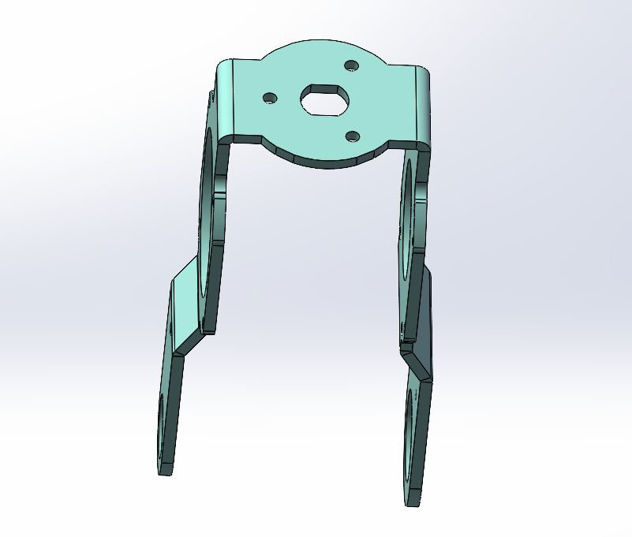 | [Part_02_Left_Right_Lower_Frame.step](./Metal_Parts/Part_02_Left_Right_Lower_Frame.step) | 钣金/铝合金-5052 / 普通阳极氧化-银色-哑光 | 2 PCS | — |
| Left Lower Frame B | 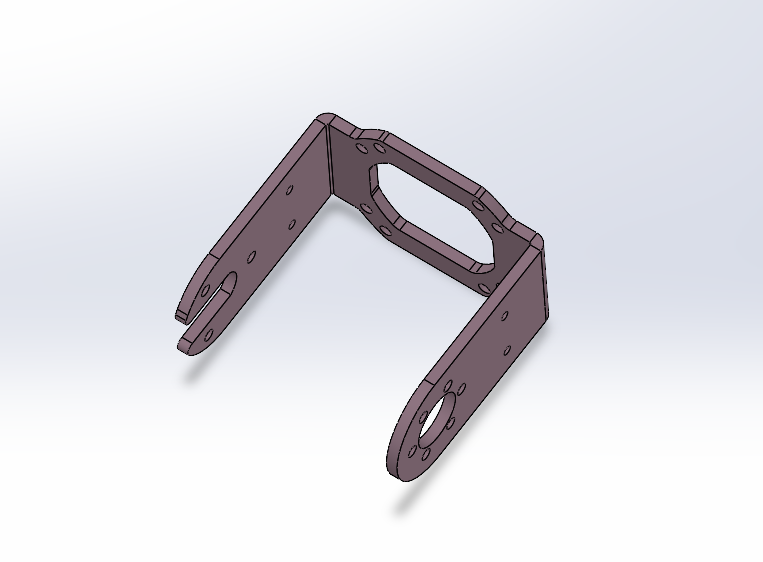 | [Part_02_Left_Lower_Frame_B.step](./Metal_Parts/Part_02_Left_Lower_Frame_B.step) | 钣金/铝合金-5052 / 普通阳极氧化-银色-哑光 | 2 PCS | — |
| Sheet Metal Base C | 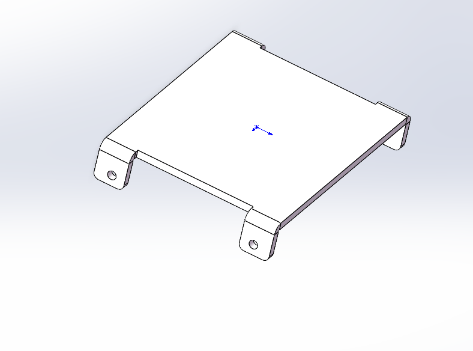 | [Part_02_Sheet_Metal_Base_C.step](./Metal_Parts/Part_02_Sheet_Metal_Base_C.step) | 钣金/铝合金-5052 / 普通阳极氧化-银色-哑光 | 1 PCS | — |
| Sheet Metal Base A | 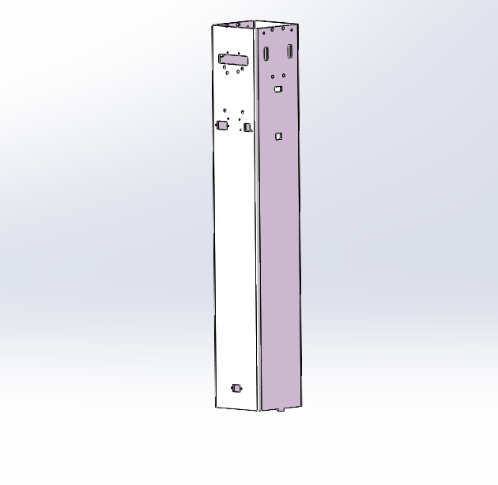 | [Part_02_Sheet_Metal_Base_A.step](./Metal_Parts/Part_02_Sheet_Metal_Base_A.step) | D235喷白漆 | 1 PCS | 与Sheet Metal Base B焊接 |
| Sheet Metal Base B | 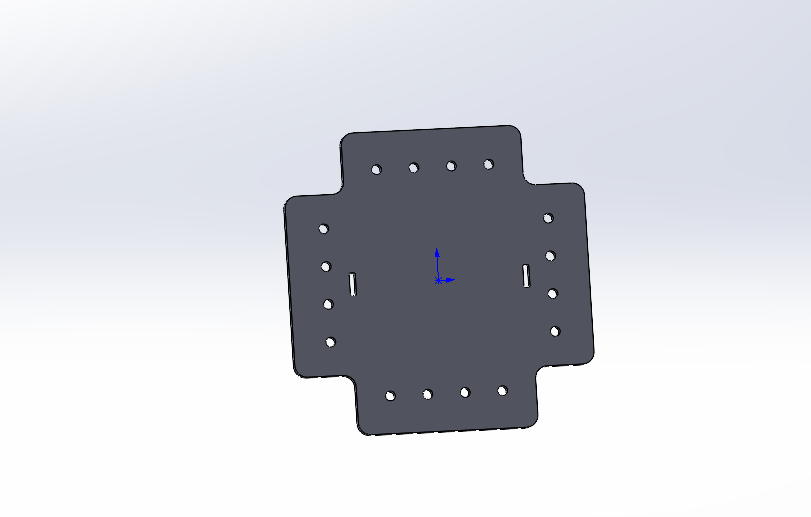 | [Part_02_Sheet_Metal_Base_B.step](./Metal_Parts/Part_02_Sheet_Metal_Base_B.step) | D235喷白漆 | 1 PCS | 与Sheet Metal Base A焊接 |

> [!TIP]
> 钣金件可在任意钣金加工厂下单（如嘉立创钣金）。5052 铝合金，普通阳极氧化银色哑光，膜厚 ≥15 µm。

---

## 🔌 关节电机

CAN 总线关节电机。

| 型号 | 参考图 | 文件名 | 总数量 | 单臂数量 | 使用部位 | Seeed 购买链接 | 参考价 |
|----------|------|--------|------|:---:|------|------|:---:|
| 7256 DNE 关节电机 | 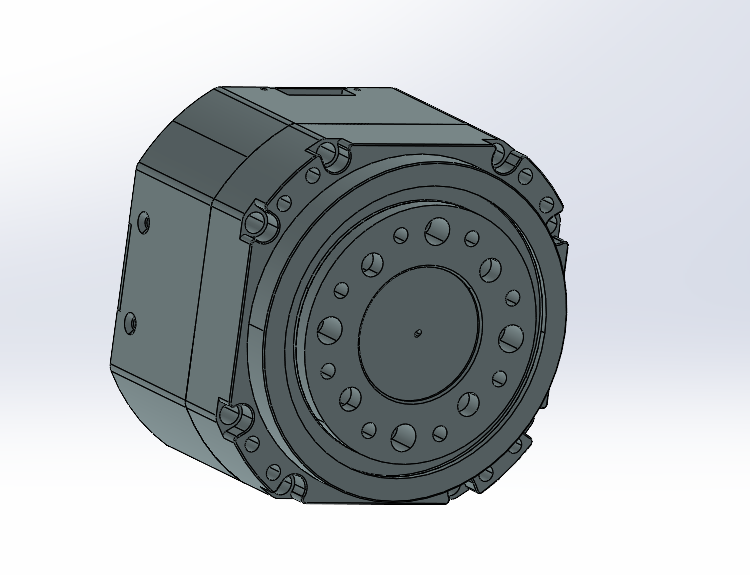 | [Part_03_7256_DNE.step](./Purchased_Parts/Part_03_7256_DNE.step) | 4 PCS | 2 | J1 / J2 | —（未上架） | $309 |
| 6056 关节电机 | 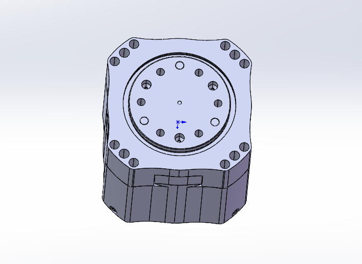 | [Part_03_6056_JC.step](./Purchased_Parts/Part_03_6056_JC.step) | 2 PCS | 1 | J3 | [HDTW-6056-36-NE-JC](https://www.seeedstudio.com/Hightorque-HDTW-6056-36-NE-JC-Actuator-p-6673.html) | $229 |
| 6056 电机（标准版） | — | [Part_03_6056.step](./Purchased_Parts/Part_03_6056.step) | 2 PCS | 1 | J4 | [HDTW-6056-36-NE](https://www.seeedstudio.com/Hightorque-HDTW-6056-36-NE-Actuator-p-6672.html) | $219 |
| 5036 关节电机 | 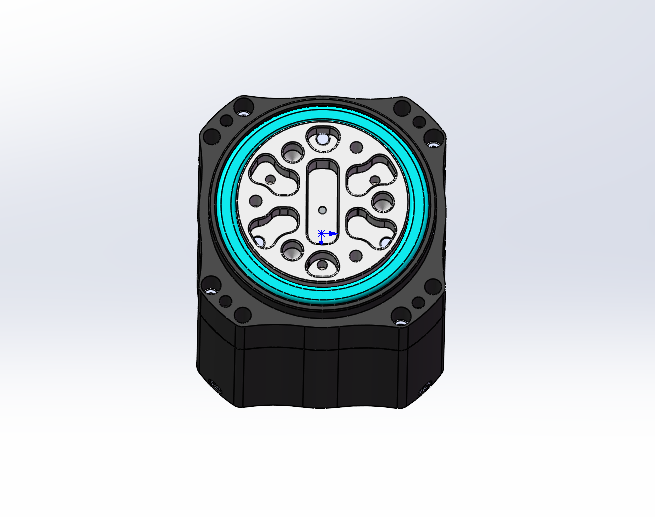 | [Part_03_5036.step](./Purchased_Parts/Part_03_5036.step) | 2 PCS | 1 | J5 | [HTDW-5036-02-DNE](https://www.seeedstudio.com/Hightorque-HTDW-5047-36-NE-Gear-Motor-p-6483.html) | $189 |
| 5047 关节电机 | 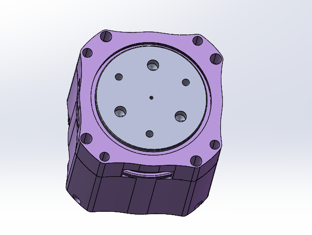 | [Part_03_5047.step](./Purchased_Parts/Part_03_5047.step) | 2 PCS | 1 | J6 | —（未上架） | $200 |
| 4438 关节电机 | 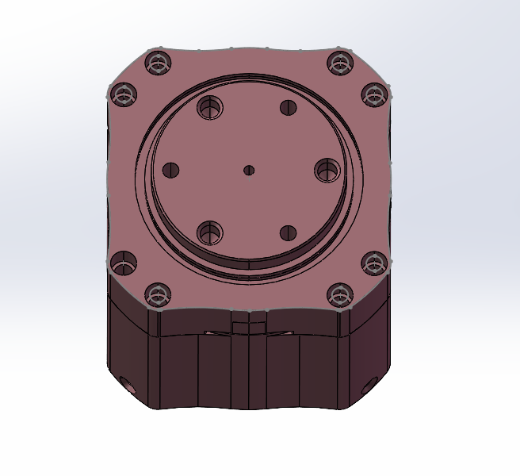 | [Part_03_4438.step](./Purchased_Parts/Part_03_4438.step) | 2 PCS | 1 | J7 | [HTDW-4438-30-NE](https://www.seeedstudio.com/Hightorque-HTDW-4438-30-NE-Gear-Motor-p-6482.html) | $189 |
| 4438 关节电机 |  | [Part_03_4438.step](./Purchased_Parts/Part_03_4438.step) | 2 PCS | 1 | 夹爪（J8） | [HTDW-4438-30-NE](https://www.seeedstudio.com/Hightorque-HTDW-4438-30-NE-Gear-Motor-p-6482.html) | $189 |

> 💡 6056-JC 为带交叉滚子版本（用于 J3）；`Part_03_6056.step` 为普通版（不带交叉滚子，用于 J4）。
>
> 💰 **电机总成本（16 台）≈ $3,666** —— Seeed 单价 × 数量；7256 DNE（$309/台）与 5047（$200/台）为预估价，商城尚未上架。

---

## 🖨️ 光固化打印件

| 零件描述 | 参考图 | 文件名 | 材质 | 数量 | 备注 |
|----------|------|--------|------|----------|------|
| 躯干前壳 | 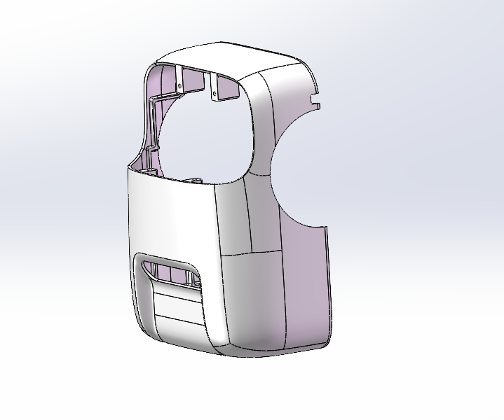 | [Part_01_Front_Torso_Shell.step](./3D_Printed_Parts/Part_01_Front_Torso_Shell.step) | 光固化/白 | 1 PCS | 打磨喷漆 |
| 躯干后壳 | 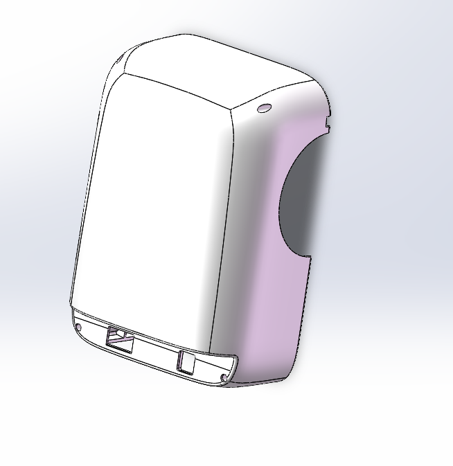 | [Part_01_Back_Torso_Shell.step](./3D_Printed_Parts/Part_01_Back_Torso_Shell.step) |  | 1 PCS | — |
| 头部眼睛组件 | 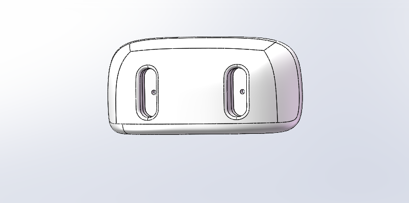 | [Part_01_Eyes.step](./3D_Printed_Parts/Part_01_Eyes.step) |  | 1 PCS | — |
| 头部眼窝 | 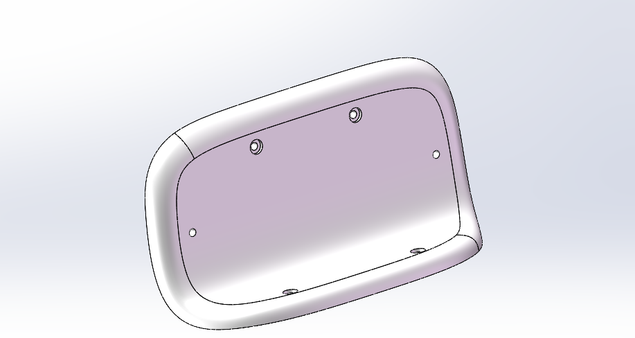 | [Part_01_Eye_Socket.step](./3D_Printed_Parts/Part_01_Eye_Socket.step) | 光固化/蓝 | 1 PCS | — |
| 左眼 |  | [Part_01_Left_Eye.step](./3D_Printed_Parts/Part_01_Left_Eye.step) | 光固化/黑 | 1 PCS | — |
| 右眼 |  | [Part_01_Right_Eye.step](./3D_Printed_Parts/Part_01_Right_Eye.step) |  | 1 pcs | — |
| Shoulder Shell A |  | [Part_01_Shoulder_Shell_A.step](./3D_Printed_Parts/Part_01_Shoulder_Shell_A.step) | 光固化/蓝 | 4 PCS | — |
| Shoulder Shell B1 |  | [Part_01_Shoulder_Shell_B1.step](./3D_Printed_Parts/Part_01_Shoulder_Shell_B1.step) | 光固化/白 | 2 pcs | — |
| Left Shoulder Shell B2 |  | [Part_01_Left_Shoulder_Shell_B2.step](./3D_Printed_Parts/Part_01_Left_Shoulder_Shell_B2.step) |  | 1 pcs | — |
| Right Shoulder Shell B2 |  | [Part_01_Right_Shoulder_Shell_B2.step](./3D_Printed_Parts/Part_01_Right_Shoulder_Shell_B2.step) |  | 1 pcs | — |
| J2 Shell A |  | [Part_01_J2_Shell_A.step](./3D_Printed_Parts/Part_01_J2_Shell_A.step) | 光固化/蓝&白 | 2 PCS | 打磨喷漆遮喷 |
| Shell B |  | [Part_01_Shell_B.step](./3D_Printed_Parts/Part_01_Shell_B.step) | 光固化/白 | 2 PCS | 打磨喷漆 |
| Upper Arm Shell A |  | [Part_01_Upper_Arm_Shell_A.step](./3D_Printed_Parts/Part_01_Upper_Arm_Shell_A.step) |  | 2 pcs | — |
| Upper Arm Shell B |  | [Part_01_Upper_Arm_Shell_B.step](./3D_Printed_Parts/Part_01_Upper_Arm_Shell_B.step) |  | 2 pcs | — |
| J5 Shell A |  | [Part_01_J5_Shell_A.step](./3D_Printed_Parts/Part_01_J5_Shell_A.step) |  | 2 pcs | — |
| J5 Shell B |  | [Part_01_J5_Shell_B.step](./3D_Printed_Parts/Part_01_J5_Shell_B.step) |  | 2 pcs | — |
| J6 Shell A |  | [Part_01_J6_Shell_A.step](./3D_Printed_Parts/Part_01_J6_Shell_A.step) | 光固化/蓝&白 | 2 pcs | 打磨喷漆遮喷 |
| J6 Shell B |  | [Part_01_J6_Shell_B.step](./3D_Printed_Parts/Part_01_J6_Shell_B.step) |  | 2 pcs | — |
| J7 shell A |  | [Part_01_J7_shell_A.step](./3D_Printed_Parts/Part_01_J7_shell_A.step) | 光固化/蓝 | 2 pcs | 打磨喷漆 |
| J7 shell B |  | [Part_01_J7_shell_B.step](./3D_Printed_Parts/Part_01_J7_shell_B.step) |  | 2 pcs | — |

### 🧩 打印建议
- 工艺：光固化（SLA/LCD），层高 0.05 mm
- 外观壳体：打磨后喷漆（颜色见表格，遮喷即双色遮蔽喷涂）
- 受力支架：对外观要求不高时可替换为 PETG / PETG-CF

---

## 🧵 FDM / 其他打印件

| 零件描述 | 参考图 | 文件名 | 材质 | 数量 | 备注 |
|----------|------|--------|------|----------|------|
| J2 Cable Chase |  | [Part_02_J2_Cable_Chase.step](./Metal_Parts/Part_02_J2_Cable_Chase.step) | PETG白色 | 2 PCS | — |
| Link Joint2 Joint3 D |   | [Part_01_Link_Joint2_Joint3_D.step](./3D_Printed_Parts/Part_01_Link_Joint2_Joint3_D.step) |  | 2 PCS | — |
| Link Joint2 Joint3 E |   | [Part_01_Link_Joint2_Joint3_E.step](./3D_Printed_Parts/Part_01_Link_Joint2_Joint3_E.step) |  | 2 PCS | — |
| J3 Cable Route A |  | [Part_01_J3_Cable_Route_A.step](./3D_Printed_Parts/Part_01_J3_Cable_Route_A.step) |  | 2 PCS | — |
| J3 Cable Route B |  | [Part_01_J3_Cable_Route_B.step](./3D_Printed_Parts/Part_01_J3_Cable_Route_B.step) |  | 2 PCS | — |
| J6–J7 线缆固定块 |  | [Part_01_J6_J7_cable_fixing_block.step](./3D_Printed_Parts/Part_01_J6_J7_cable_fixing_block.step) |  | 2 PCS | — |
| Intel RealSense D405 腕部相机支架 |  | [Part_01_Realsense405_Mount.step](./3D_Printed_Parts/Part_01_Realsense405_Mount.step) |  | 2 PCS | — |
| J5 夹线块 |  | [Part_01_J5_Cramping_block.step](./3D_Printed_Parts/Part_01_J5_Cramping_block.step) |  | 4 PCS | — |
| Intel RealSense D435 头部相机支架 |  | [Part_01_D435_Mount.step](./3D_Printed_Parts/Part_01_D435_Mount.step) |  | 1 PCS | — |
| MCU 控制板支架 |  | [Part_01_MCU_Contorler_Mount.step](./3D_Printed_Parts/Part_01_MCU_Contorler_Mount.step) |  | 1 PCS | — |
| Jetson Orin 计算模块支架 |  | [Part_01_Orin_Mount.step](./3D_Printed_Parts/Part_01_Orin_Mount.step) |  | 1 PCS | — |
| HDMI 模块支架 A |  | [Part_01_HDMI_Mount_A.step](./3D_Printed_Parts/Part_01_HDMI_Mount_A.step) |  | 1 PCS | — |
| HDMI 模块支架 B |  | [Part_01_HDMI_Mount_B.step](./3D_Printed_Parts/Part_01_HDMI_Mount_B.step) |  | 1 PCS | — |

### 🧩 打印建议
- 层高 0.2 mm，喷嘴 0.4 mm
- 线缆导向件与非外观支架：PETG 或 PETG-CF，填充 ≥30%

---

## 🤏 夹爪手指

| 零件描述 | 参考图 | 文件名 | 材质 | 数量 | 备注 |
|----------|------|--------|------|----------|------|
| 夹爪手指 A（固定） |  | [Part_02_Finger_A.step](./Metal_Parts/Part_02_Finger_A.step) |  | 4 PCS | — |
| 夹爪手指 B（可动） |  | [Part_01_Finger_B.step](./3D_Printed_Parts/Part_01_Finger_B.step) |  | 4 PCS | 复模 |

---

## 🛒 标准采购件

> [!NOTE]
> 标准件数量均为一整台双臂平台（两条手臂 + 躯干）的总用量，采购请自行备余量。淘宝与 Amazon 链接及价格均为 2026-11 抓取：淘宝为商品页起售价（随规格与数量变化），仅供采购参考。

### 轴承与直线运动件

| 零件 | 规格 | 数量 | 文件名 | 淘宝链接 | Amazon 链接（参考价） |
|----------|------|:---:|------|------|------|
| 深沟球轴承 30×42×7（6806） | 30×42×7 | 2 | [Part_03_30x42x7_Bearing.step](./Purchased_Parts/Part_03_30x42x7_Bearing.step) | [¥16](https://item.taobao.com/item.htm?id=709383643059) | [$12.99 / 10 pcs](https://www.amazon.com/dp/B0GRRF5CQ6) |
| 球轴承 25×32×4（6705） | 25×32×4 | 2 | [Part_03_Bearing_25x32x4.step](./Purchased_Parts/Part_03_Bearing_25x32x4.step) | [¥3](https://detail.tmall.com/item.htm?id=617257760826) | [$9.19 / 4 pcs](https://www.amazon.com/dp/B0CNX4XQWS) |
| 球轴承 4×10×4（MR104） | 4×10×4 | 12 | [Part_03_Bearing_4-10-4.step](./Purchased_Parts/Part_03_Bearing_4-10-4.step) | [¥3.6](https://detail.tmall.com/item.htm?id=662290112665) | [$8.99 / 10 pcs](https://www.amazon.com/dp/B09DK3SQGR) |
| 鱼眼轴承 GE4C | GE4C | 8 | [Part_03_rod_end_bearing.step](./Purchased_Parts/Part_03_rod_end_bearing.step) | [¥1.93](https://detail.tmall.com/item.htm?id=677660355770) | [$17.89 / 1 pc](https://www.amazon.com/dp/B0FKY137B7) |
| 法兰轴承 F6804ZZ | 20×32×7 | 2 | — | [¥4.2](https://item.taobao.com/item.htm?id=783625634054) | [$4.66 / 2 pcs](https://www.amazon.com/dp/B0CP48SK8N) |
| 法兰轴承 F688ZZ | 8×16×5 | 2 | [Part_03_F688ZZ.step](./Purchased_Parts/Part_03_F688ZZ.step) | [¥0.85](https://item.taobao.com/item.htm?id=787436638716) | [$7.99 / 10 pcs](https://www.amazon.com/dp/B0CZNCXY5T) |
| 法兰轴承 F6803ZZ | 17×26×5 | 2 | [Part_03_F6703ZZ.step](./Purchased_Parts/Part_03_F6703ZZ.step) | [¥4.2](https://item.taobao.com/item.htm?id=783625634054) | [$6.49 / 2 pcs](https://www.amazon.com/dp/B0CP485RPH) |
| 导轨 MGN9（夹爪用 150 mm） | MGN9 防锈导轨 | 2 | [Part_03_MGN9-163mm.step](./Purchased_Parts/Part_03_MGN9-163mm.step) | [¥3](https://item.taobao.com/item.htm?id=1054825865658) | [$17.89 / 150 mm 轨+滑块](https://www.amazon.com/dp/B09SD9N2Q5) |
| MGN9C 滑块 | MGN9C 标准滑块 | 4 | — | [¥5](https://detail.tmall.com/item.htm?id=709992228016) | [$23.17](https://www.amazon.com/dp/B08ZS5S16W) |

### 🔩 螺丝 / 紧固件 BOM 总表

> [!NOTE]
> 由于螺丝数量较多（36 种规格、共 558 颗），统一放在本类目汇总介绍，**不按单个关节拆分**。数据统计自整机装配模型的 `03_Screws` 紧固件集合（2026-11-14）；命名代号即装配树中的组件名（HM=圆柱头 / KM=锥形沉头 / PM=平圆头 / FM=平头 / DX=定位销 / SS=塞打 / PW=十字带垫）。
> 淘宝与 Amazon 链接及价格均为 2026-11 抓取，仅供采购参考；淘宝价格为商品页起售价。
> 💡 36 种规格按 Amazon 参考价各购一包，合计 ≈ **$283**；多数包装数量大于整机实际用量。

| 序号 | 类型 | 规格型号 | 命名代号 | 数量（颗） | 淘宝购买链接 | Amazon 链接 |
| :---: | :--- | :--- | :--- | :---: | :--- | :--- |
| 1 | 内六角圆柱头螺钉 | M2.5×12 | 03_HM2.5x12 | 1 | [¥1.12](https://item.taobao.com/item.htm?id=963493924490) | [$6.99](https://www.amazon.com/dp/B0CG29YCKW) |
| 2 | 内六角圆柱头螺钉 | M2.5×20 | 03_HM2.5x20 | 24 | [¥1.7](https://item.taobao.com/item.htm?id=974509690514) | [$8.99 / 105 pcs](https://www.amazon.com/dp/B0CXQ3TVF2) |
| 3 | 内六角圆柱头螺钉 | M3×8 | 03_HM3x8 | 24 | [¥1.12](https://item.taobao.com/item.htm?id=521228382978) | [$6.76 / 100 pcs](https://www.amazon.com/dp/B07CMQ1SQH) |
| 4 | 内六角圆柱头螺钉 | M3×10 | 03_HM3x10 | 130 | [¥1.12](https://item.taobao.com/item.htm?id=521228382978) | [$6.99 / 50 pcs](https://www.amazon.com/dp/B0GH3QWSKV) |
| 5 | 内六角圆柱头螺钉 | M3×12 | 03_HM3x12 | 9 | [¥1.12](https://item.taobao.com/item.htm?id=739797941952) | [$6.99 / 50 pcs](https://www.amazon.com/dp/B0GH4SV878) |
| 6 | 内六角圆柱头螺钉 | M3×18 | 03_HM3x18 | 4 | [¥5.98](https://item.taobao.com/item.htm?id=918484403235) | [$6.99 / 100 pcs](https://www.amazon.com/dp/B07CMX3MCW) |
| 7 | 内六角圆柱头螺钉 | M3×20 | 03_HM3x20 | 12 | [¥1.06](https://item.taobao.com/item.htm?id=894456862974) | [$8.99 / 180 pcs](https://www.amazon.com/dp/B0DJQHC7K9) |
| 8 | 内六角圆柱头螺钉 | M4×8 | 03_HM4x8 | 16 | [¥5.98](https://item.taobao.com/item.htm?id=521228382978) | [$6.99 / 50 pcs](https://www.amazon.com/dp/B0GCSQ6F9Z) |
| 9 | 内六角圆柱头螺钉 | M4×10 | 03_HM4x10 | 8 | [¥1.12](https://item.taobao.com/item.htm?id=788815662638) | [$6.99 / 50 pcs](https://www.amazon.com/dp/B0GCSJR229) |
| 10 | 内六角圆柱头螺钉 | M4×12 | 03_HM4x12 | 20 | [¥1.06](https://item.taobao.com/item.htm?id=788815662638) | [$8.99 / 120 pcs](https://www.amazon.com/dp/B0DYMS1VVC) |
| 11 | 内六角圆柱头螺钉 | M4×15 | 03_HM4x15 | 44 | [¥5.98](https://item.taobao.com/item.htm?id=963493924490) | [$7.29](https://www.amazon.com/dp/B0CG28M5HK) |
| 12 | 内六角圆柱头螺钉 | M4×20 | 03_HM4x20 | 4 | [¥1.06](https://item.taobao.com/item.htm?id=521228382978) | [$7.99 / 50 pcs](https://www.amazon.com/dp/B0GH629T8X) |
| 13 | 内六角圆柱头螺钉 | M8×12 | 03_HM8x12 | 8 | [¥5.98](https://item.taobao.com/item.htm?id=830203292518) | [$13.99](https://www.amazon.com/dp/B0BHLZJWK6) |
| 14 | 内六角锥形沉头螺钉 | M3×8 | 03_KM3x8 | 2 | [¥3.6](https://item.taobao.com/item.htm?id=993726910144) | [$6.49](https://www.amazon.com/dp/B01D8L4XVE) |
| 15 | 内六角锥形沉头螺钉 | M3×10 | 03_KM3x10 | 6 | [¥3.6](https://detail.tmall.com/item.htm?id=960239468310) | [$8.99](https://www.amazon.com/dp/B08HNF3J3D) |
| 16 | 内六角锥形沉头螺钉 | M3×16 | 03_KM3x16 | 16 | [¥3.6](https://detail.tmall.com/item.htm?id=693391661520) | [$6.39 / 100 pcs](https://www.amazon.com/dp/B0CQ4YS4CR) |
| 17 | 内六角锥形沉头螺钉 | M3×20 | 03_KM3x20 | 6 | [¥1.5](https://detail.tmall.com/item.htm?id=693391661520) | [$8.99 / 100 pcs](https://www.amazon.com/dp/B0GDWH9DZK) |
| 18 | 内六角锥形沉头螺钉 | M4×8 | 03_KM4x8 | 12 | [¥3.96](https://detail.tmall.com/item.htm?id=693391661520) | [$7.49 / 50 pcs](https://www.amazon.com/dp/B0H7WNNXG4) |
| 19 | 内六角锥形沉头螺钉 | M4×16 | 03_KM4x16 | 4 | [¥2.15](https://detail.tmall.com/item.htm?id=693391661520) | [$8.99](https://www.amazon.com/dp/B08P5LTXN1) |
| 20 | 内六角平圆头螺钉 | M3×10 | 03_PM3x10 | 8 | [¥1.7](https://item.taobao.com/item.htm?id=638405691603) | [$7.69 / 100 pcs](https://www.amazon.com/dp/B0GH67N6D6) |
| 21 | 内六角平圆头螺钉 | M3×22 | 03_PM3x22 | 16 | [¥0.29](https://item.taobao.com/item.htm?id=40344704723) | [$14.39](https://www.amazon.com/dp/B01B1ODKWS) |
| 22 | 内六角平圆头螺钉 | M4×8 | 03_PM4x8 | 10 | [¥1.7](https://detail.tmall.com/item.htm?id=622200135746) | [$8.99](https://www.amazon.com/dp/B09ZH4TFPC) |
| 23 | 内六角平圆头螺钉 | M4×10 | 03_PM4x10 | 14 | [¥1.7](https://item.taobao.com/item.htm?id=751159860192) | [$7.99 / 50 pcs](https://www.amazon.com/dp/B0GGGDWNFL) |
| 24 | 内六角平圆头螺钉 | M4×12 | 03_PM4x12 | 12 | [¥1.7](https://item.taobao.com/item.htm?id=712350081913) | [$7.99 / 50 pcs](https://www.amazon.com/dp/B0GJHXFBPP) |
| 25 | 内六角平圆头螺钉 | M4×15 | 03_PM4x15 | 16 | [¥1.7](https://detail.tmall.com/item.htm?id=585902280402) | [$7.99 / 105 pcs（M4×16 近似）](https://www.amazon.com/dp/B0DJMYLXBG) |
| 26 | 内六角平头螺钉 | M3×8 | 03_FM3x8 | 38 | [¥0.23](https://item.taobao.com/item.htm?id=1060954762230) | [$7.99](https://www.amazon.com/dp/B09HS9GMG3) |
| 27 | 内六角平头螺钉 | M3×12 | 03_FM3x12 | 6 | [¥0.23](https://detail.tmall.com/item.htm?id=693391661520) | [$9.49 / 多规格套装（含 M3×12）](https://www.amazon.com/dp/B0CZQRM3QH) |
| 28 | 内六角平头螺钉 | M3×14 | 03_FM3x14 | 2 | [¥1.85](https://detail.tmall.com/item.htm?id=693391661520) | [$6.99](https://www.amazon.com/dp/B0CG1PW698) |
| 29 | 内六角平头螺钉 | M3×16 | 03_FM3x16 | 10 | [¥1.38](https://item.taobao.com/item.htm?id=40257027484) | [$6.39 / 100 pcs](https://www.amazon.com/dp/B0CQ4YS4CR) |
| 30 | 内六角平头螺钉 | M3×20 | 03_FM3x20 | 12 | [¥1.5](https://detail.tmall.com/item.htm?id=693391661520) | [$9.49](https://www.amazon.com/dp/B0CZR9BD83) |
| 31 | 内六角平头螺钉 | M5×12 | 03_FM5x12 | 16 | [¥1.83](https://detail.tmall.com/item.htm?id=693391661520) | [$5.99 / 25 pcs](https://www.amazon.com/dp/B0G19G1RC7) |
| 32 | 圆柱定位销 | Φ3×6 | 03_DX3x6 | 12 | [¥0.04](https://item.taobao.com/item.htm?id=751868311463) | [$5.99 / 60 pcs](https://www.amazon.com/dp/B0DZ22L7BL) |
| 33 | 圆柱定位销 | Φ4×6 | 03_DX4x6 | 18 | [¥0.04](https://item.taobao.com/item.htm?id=751868311463) | [$5.19 / 50 pcs](https://www.amazon.com/dp/B0DYSV19YB) |
| 34 | 圆柱定位销 | Φ4×8 | 03_DX4x8 | 6 | [¥0.04](https://item.taobao.com/item.htm?id=920605573925) | [$6.69 / 55 pcs](https://www.amazon.com/dp/B0FW3VDGRQ) |
| 35 | 塞打螺丝（轴肩螺钉） | d4×6×M3 | 03_shoulder_screw_d4x6xM3 | 4 | [¥1.6](https://item.taobao.com/item.htm?id=752230143589) | [$7.40 / 26 pcs](https://www.amazon.com/dp/B0FDPV2411) |
| 36 | 十字带垫螺丝 | M2×4×6 | 03_PM2x4x6 | 8 | [¥1.5](https://item.taobao.com/item.htm?id=40233527435) | [$3.99 / 981 pcs（M2 套装，近似）](https://www.amazon.com/dp/B0GCGVJ1JQ) |
| **总计** | **36 种规格** |  |  | **558** |  |  |

**按类型汇总**

| 类型 | 代号 | 规格数 | 数量（颗） |
| :--- | :---: | :---: | :---: |
| 内六角圆柱头螺钉 | HM | 13 | 304 |
| 内六角锥形沉头螺钉 | KM | 6 | 46 |
| 内六角平圆头螺钉 | PM | 6 | 76 |
| 内六角平头螺钉 | FM | 6 | 84 |
| 圆柱定位销 | DX | 3 | 36 |
| 塞打螺丝（轴肩螺钉） | SS | 1 | 4 |
| 十字带垫螺丝 | PW | 1 | 8 |
| **总计** |  | **36** | **558** |

### 其他标准件

| 零件 | 规格 | 数量 | 文件名 | 淘宝链接 | Amazon 链接（参考价） |
|----------|------|:---:|------|------|------|
| 六角铜螺柱 | M3×14 双通 | 32 | — | [¥2.55](https://detail.tmall.com/item.htm?id=1071230029834) | [$8.99 / 25 pcs（M3×15 近似）](https://www.amazon.com/dp/B015A3LHL2) |
| 六角铜螺柱 | M3×8 双通 | 8 | — | [¥0.07](https://detail.tmall.com/item.htm?id=1070165098977) | [$5.15 / 100 pcs](https://www.amazon.com/dp/B09L5L4DP7) |
| G 型夹 2 寸（夹持 58 mm） | — | 2 | — | [¥2](https://item.taobao.com/item.htm?id=521150294712) | [$12.29 / 2 pcs](https://www.amazon.com/dp/B0CRVGVJQ1) |
| 塞打螺丝 4×6×M3（变体） | d4×6×M3 | 4 | [Part_03_shoulder_screw4x6xM3.step](./Purchased_Parts/Part_03_shoulder_screw4x6xM3.step) | [¥1.6](https://item.taobao.com/item.htm?id=752230143589) | [$7.40 / 26 pcs](https://www.amazon.com/dp/B0FDPV2411) |

### 传感器（相机）

| 零件 | 型号 | 数量 | 文件名 | 官方购买链接（Seeed） | Amazon 链接（参考价） |
|----------|------|:---:|------|------|------|
| Intel RealSense D405 深度相机（腕部） | D405 | 2 | [Part_03_RealSense_D405.step](./Purchased_Parts/Part_03_RealSense_D405.step) | [Seeed Studio](https://www.seeedstudio.com/RealSense-D405-3D-Camera-p-6758.html) | [$444.00](https://www.amazon.com/dp/B0H357JD93) |
| Intel RealSense D435i 深度相机（头部） | D435i | 1 | [Part_03_RealSense_D435.step](./Purchased_Parts/Part_03_RealSense_D435.step) | [Seeed Studio](https://www.seeedstudio.com/Intel-RealSense-Depth-Camera-D435i-p-4423.html) | [$559.99](https://www.amazon.com/dp/B07MWR2YJB) |

---

## 🧠 控制器

| 零件描述 | 文件名 | 数量 | 备注 |
|----------|--------|:---:|------|
| 通用盒子 7-CAN 控制板（V1.2） | [Part_03_MCU_Controler.step](./Purchased_Parts/Part_03_MCU_Controler.step) | 1 PCS | 双臂供电 + CAN 总线分配 |

通用盒子 7-CAN 控制板负责供电与 CAN 总线分配，双臂与夹爪的走线均汇入躯干。

---

## 🔌 线束

以下线束均需**定制加工**（XT30 2+2 供电 + CAN 总线，关节间串接）。

| 线束 | 规格 | 数量 | 备注 |
|----------|------|:---:|------|
| 电源输入 | XT30(2+2)，一正弯一直，灰色扁线，320 mm | 2 PCS | 主电源输入 |
| J1–J2 | XT30(2+2)，两端正/反弯，红黑线，300 mm，套螺纹管 120 mm，弯头打胶固定 | 2 PCS | 肩部线束 |
| J2–J3 | XT30(2+2)，两端弯头，灰色圆线，120 mm | 2 PCS | — |
| J3–J4 | XT30(2+2)，两端弯头，红黑线，190 mm | 2 PCS | — |
| J4–J5 | XT30(2+2)，双正弯，红黑线，240 mm，套螺纹管 160 mm | 2 PCS | — |
| J5–J6 | XT30(2+2)，双正弯，红黑线，100 mm | 2 PCS | — |
| J6–J7 | XT30(2+2)，长度以工程 BOM 为准 | 2 PCS | — |

---

## 🏷️ 许可证

硬件设计 © 2026 Seeed Studio Co., Ltd. [CERN-OHL-W-2.0](https://ohwr.org/cern_ohl_w_v2.txt) 开源。详见[仓库 LICENSE](../../LICENSE)。
